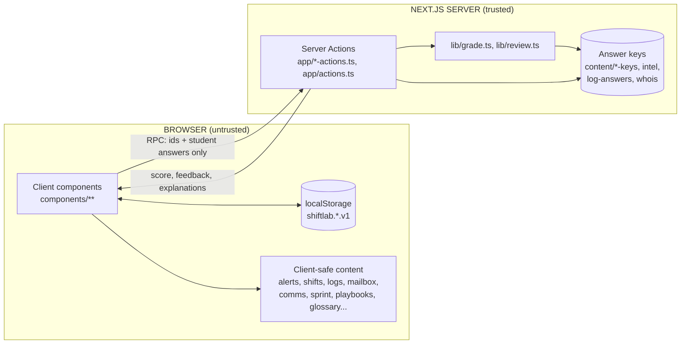
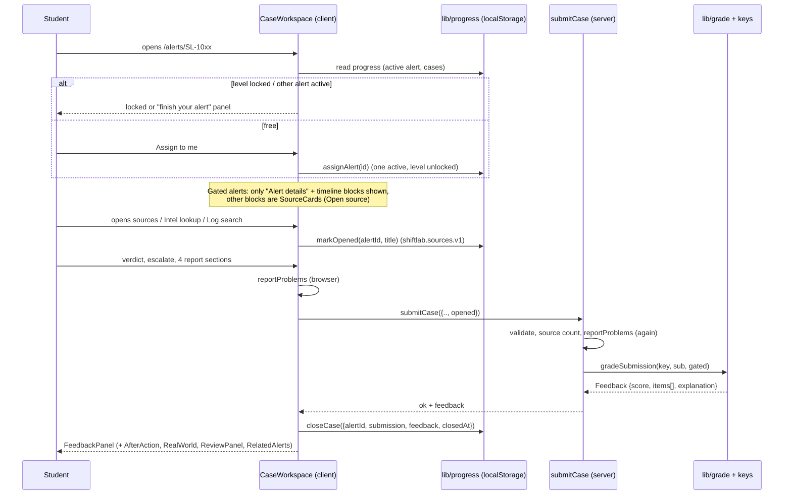
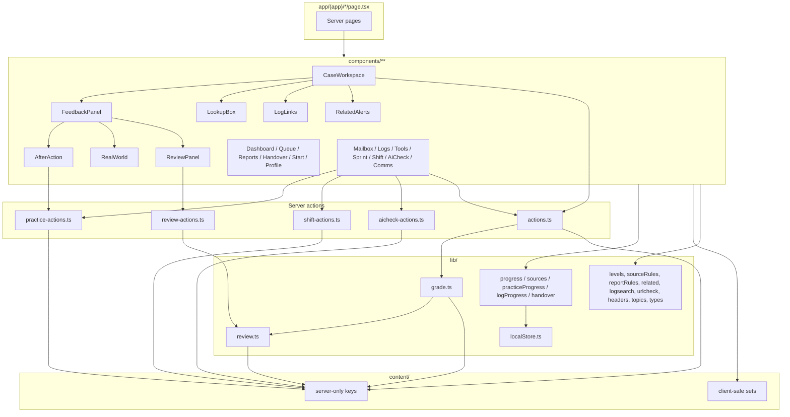

# BRAIN.md — ShiftLab single source of truth

> Written 2026-10-27 by reverse-engineering the code. Read this before touching the repo.
> Where this file and the code disagree, the code wins. Then fix this file.
> Companion docs: `CLAUDE.md` (hard rules), `AGENTS.md` (Next.js 16 warning), `PLAN.md` (roadmap log).

---

## 0. 60-second summary

**ShiftLab** is a free, browser-based **SOC Level 1 analyst simulator**. A student plays an L1 analyst at a fictional company (**Harbor & Pine Logistics**). They take security alerts from a queue, read evidence, decide **true positive / false positive**, decide **escalate or not**, and write a four-part case report. A server-side grader scores them and coaches them. Around that core sit practice modules (phishing mailbox, log search, triage sprint, shift planner, AI-draft checker, comms, tools, playbooks, glossary).

| Fact | Value |
|---|---|
| Stack | Next.js **16.4.3** App Router, React **19.3.0**, TypeScript strict, Tailwind **v4**, ESLint 9 |
| Backend | **Supabase (accounts, analytics and saved progress, steps 1 to 3).** Sign up / sign in / sign out / password reset, a `profiles` table with a role, a name, a photo, a username and a GitHub link (people edit their own; a new account must finish a welcome screen first, §5d), and an insert-only `events` table behind an admin-only dashboard at `/admin` (§5e). Progress lives in `cases` and `saved_state` (§5f). Two env vars (`.env.local`, publishable key only). Everything else is still Next.js **Server Actions** with no database (§5d) |
| Persistence | Progress and scores: browser `localStorage` only (13 keys, all `shiftlab.*.v1`; the 13th, `shiftlab.vid.v1`, is the anonymous visitor id used for counting visits). Accounts: Supabase (`auth.users` + `public.profiles`). Signed-in students' progress is also saved to Supabase and merged back on sign-in (§5f); guests stay browser-only |
| Content | 38 alerts in 4 levels, all fictional (`.test` domains, RFC 5737 documentation IPs) |
| Secrets model | Answer keys and grading code run on the server only. Convention, not a framework guard (see §11) |
| Build status | `npm run build` was run on the author's machine on 2026-10-27 and finished with the route table (static and partial-prerender legend); the top of the output was not inspected for warnings. Dev server also returned 200 for all 38 alert routes. **`npm run lint` has NOT been run** |
| Tests in repo | **Yes, content and safety checks:** `npm test` (11 checks in `tests/`, plain Node, no packages) plus a GitHub Action. UI, grading and sync checks were still done with throw-away scripts outside the repo (see §15) |
| Deployed | **Yes (2026-10-30), free:** Cloudflare Workers via the OpenNext adapter, at `https://shiftlab.blueteam-labs.workers.dev`. Code is in a private GitHub repo (`sai-707/shiftlab`, branch `main`); every push rebuilds and redeploys (§16). No custom domain yet |

**The one rule that explains the whole architecture:** *the browser may see questions, never answers.* Everything below (server actions, `content/*-keys.ts`, `lib/grade.ts`, `lib/review.ts`) exists to enforce it.

---

## 1. Product intent, audience and constraints

- **Owner/audience:** a third-year BTech CSE student building a resume/portfolio project targeting SOC L1 jobs. Users are other beginners.
- **Why it exists:** most SOC training shows answers or uses real data. ShiftLab makes the student *decide first*, then explains. It trains: triage judgement, evidence reading, report writing, communication, tool use, and (new) judging AI output.
- **Hard constraints** (from `CLAUDE.md`):
  1. Answer keys and scoring are server-only.
  2. One active alert per user (today a client rule; later a DB unique partial index).
  3. Admin is a **role checked on the server**, never a client flag.
  4. Original branding. All data fictional.
  5. Smallest working thing. Deferred work is marked `shortcut: <limit>, <when to upgrade>` in a comment.
  6. Structure: public pages `app/page.tsx` + `app/login` + `app/signup` (built, §5c), signed-in app `app/(app)`, planned `app/admin`.
- **Tone of copy:** plain English, short sentences, beginner-friendly. Keep it that way.

---

## 2. Tech stack, configuration and gotchas

### 2.1 Dependencies (`package.json`)
- Runtime: `next@16.4.3`, `react@19.3.0`, `react-dom@19.3.0`, plus the Supabase client packages. No UI kit, no state library, no test framework (tests use Node's built-in runner).
- Dev: `tailwindcss@^4`, `@tailwindcss/turbopack@^4`, `typescript@^5`, `@types/node@^20`, `eslint@^9`, `eslint-config-next@16.4.3`.
- Scripts: `dev`, `build`, `start`, `lint`, `test` (Node 22.6+, runs `tests/*.test.mjs` with `--experimental-strip-types`), `preview`, `deploy`, `upload`. No `typecheck`.

### 2.2 Config files
| File | What matters |
|---|---|
| `next.config.ts` | `cacheComponents: true`, `partialPrefetching: true`, `allowedDevOrigins: ["192.168.1.6"]` (**hard-coded dev shortcut**; change if your LAN IP changes; only affects `npm run dev`), and a Turbopack rule routing `*.css` through `@tailwindcss/turbopack` |
| `tsconfig.json` | `strict`, path alias `@/*` → repo root, Next plugin |
| `eslint.config.mjs` | `eslint-config-next` flat config |
| `.gitignore` | ignores `.env*`, `.next`, `next-env.d.ts` |
| `.claude/settings.json` | PreToolUse hooks for **graphify** (a knowledge-graph tool). They call `C:/Users/Admin/AppData/Local/Programs/Python/Python312/Scripts/graphify.EXE` (Windows-specific path). `graphify-out/` does not exist yet |
| `README.md` | Real project README (what it is, live link, screenshots in `docs/`, how to run, tests). Update it when features change |

### 2.3 Next.js 16 gotchas (READ `node_modules/next/dist/docs/` before changing framework code — `AGENTS.md`)
- **`cacheComponents: true`** means dynamic data must be read inside `<Suspense>` or the route cannot prerender. This is why:
  - `app/(app)/layout.tsx` wraps the page with `<Suspense>` and renders `Sidebar` (which reads the path at request time).
  - `app/(app)/alerts/[id]/page.tsx` reads `params` inside an `async` child under `<Suspense>`, and exports `generateStaticParams()` from `ALERTS`.
- `params` is a **Promise** (`await params`).
- Root layout uses the generated `LayoutProps<"/">` type.
- Fonts: **Inter** and **JetBrains Mono** via `next/font/google` in `app/layout.tsx` (needs network at build time).
- `app/page.tsx` just `redirect("/dashboard")`. `shortcut:` until a landing page exists.

### 2.4 Styling system
- Tailwind v4, tokens defined once in `app/globals.css`: `bg-canvas`, `bg-panel`, `bg-raised`, `border-line`, `text-ink`, `text-muted`, `text-accent` (cyan), severity `critical|high|medium|low`, `text-correct`, `text-missed`.
- **Never use raw hex in components.** Exceptions that already exist: topic dots in `lib/topics.ts` (`TOPIC_COLOR`, AI = `#e879f9`) and the dashboard ring.
- `.rise` entrance animation has a `prefers-reduced-motion` off switch.
- Gotcha: tokens are named `ink`/`muted`, not `fg`. `text-fg` does not exist.
- Tailwind v4 `has-checked:` and `has-[:checked]:` variants are both used on radio labels. Keep the surrounding pattern when copying.

---

## 3. Repository map

```
shiftlab/
├─ app/
│  ├─ layout.tsx            root: fonts, <html>, globals.css
│  ├─ page.tsx              LANDING page (public, see §5c)
│  ├─ login/page.tsx signup/page.tsx reset-password/page.tsx   thin pages over components/site/AuthPage
│  ├─ auth-actions.ts       "use server": signUp, signIn, signOut, requestPasswordReset, updatePassword (§5d)
│  ├─ auth/callback/route.ts   emailed code -> session
│  ├─ profile-actions.ts    "use server": saveProfile (name and photo of the signed-in person, §5d)
│  ├─ admin/                layout.tsx (admin gate, 404 for non-admins, then the shell) page.tsx (Dashboard) analytics/page.tsx (Analytics) (§5e)
│  ├─ welcome/page.tsx      first screen for a new account: name, username, photo, GitHub (§5d)
│  ├─ api/e/route.ts        POST: page-view beacon from the browser (§5e)
│  ├─ globals.css           Tailwind v4 + theme tokens
│  ├─ actions.ts            "use server": submitCase, lookupIndicator, checkLogAnswer
│  ├─ practice-actions.ts   "use server": checkMail, checkMessage, checkSprint, checkAfterAction, whoisLookup
│  ├─ review-actions.ts     "use server": reviewCase  (feedback only, never scores)
│  ├─ shift-actions.ts      "use server": checkShift
│  ├─ aicheck-actions.ts    "use server": checkAiDraft
│  └─ (app)/                route group: everything inside the sidebar shell
│     ├─ layout.tsx         <Suspense> + <Sidebar/> + <main md:pl-60>
│     ├─ dashboard queue alerts/[id] reports handover profile start practice
│     ├─ playbooks playbooks/[slug] glossary
│     ├─ mailbox logs lookup tools sprint shift ai-check comms
├─ components/              all UI (28 files). Almost every one is "use client"
│  ├─ case/       CaseWorkspace* FeedbackPanel AfterAction ReviewPanel LogLinks RealWorld RelatedAlerts
│  ├─ layout/{Sidebar,SidebarAccount}  ui/{PageHeader,SeverityBadge,ComingSoon,UserMenu,icons}
│  ├─ profile/    ProfileView SetupForm ProfileDetails AccountCard ExportSummary ResetProgress (§5d)
│  ├─ admin/      AdminShell (client: sidebar + header, account menu at the header's right end) AdminDashboard AnalyticsView parts AreaChart (cards are server-rendered, no chart library, §5e)
│  ├─ analytics/  Tracker (page-view beacon, mounted once in app/layout.tsx)
│  ├─ site/       PUBLIC pages only: site.css SiteShell Beams SiteEffects DottedWordmark AlertDemo AuthCard ResetCard PasswordMeter AuthPage links.ts (§5c, §5d)
│  └─ dashboard queue reports handover profile start playbooks glossary lookup
│     logs mailbox tools sprint shift aicheck comms     (one View per page)
├─ content/                 ALL scenario data. 40 files. Two kinds (see §6)
│  ├─ client-safe: alerts shifts aicheck logs mailbox comms sprint glossary playbooks
│  │               practiceHub afteraction logLinks realworld related
│  └─ SERVER-ONLY: answer-keys review-keys investigation-keys intel log-answers whois
│                  mailbox-keys comms-keys sprint-keys afteraction-keys shift-keys aicheck-keys
├─ lib/                     pure logic and stores
│  ├─ SERVER-SIDE logic: grade.ts review.ts (import server-only content)
│  ├─ shared pure logic: reportRules answer indicator levels sourceRules related logsearch urlcheck headers topics types authChecks
│  └─ CLIENT stores: localStore progress sources handover logProgress practiceProgress
├─ lib/supabase/            server.ts (client per request) proxy.ts (session refresh)
├─ lib/account.ts           getAccount(): session + profile row, once per request (§5d)
├─ lib/track.ts             server: track(kind, ...) adds one row to events, never throws (§5e)
├─ lib/adminData.ts adminStats.ts   admin numbers via database functions; pure formatting helpers (§5e)
├─ lib/profileRules.ts      name / photo / username / GitHub rules shared by the browser and the server (§5d)
├─ proxy.ts                 Next 16 proxy: calls lib/supabase/proxy.ts on every request
├─ supabase/migrations/     0001_profiles.sql, 0002_profile_details.sql, 0003_analytics.sql, 0004_profile_identity.sql (run by hand, in order, in the Supabase SQL Editor)
├─ supabase/demo/           seed_demo_events.sql (made-up guest traffic to preview the dashboard; delete with the line inside it)
├─ public/                  static assets
├─ CLAUDE.md AGENTS.md PLAN.md README.md BRAIN.md
└─ package.json next.config.ts tsconfig.json eslint.config.mjs next-env.d.ts
```
`*` CaseWorkspace is the heart of the product (see §8.1). ~8.5k lines of TS in `content`, `lib` and `app/*.ts` together.

**Sandbox note:** the working copy this file was produced from lacked `package.json`, `README.md`, `AGENTS.md`, `tsconfig.json`, `eslint.config.mjs`, `public/` and `lib/scoring.ts`. The user's machine has them. `lib/scoring.ts` is **unused** and should be deleted.

---

## 4. Architecture

### 4.1 Trust boundary (the most important diagram)



- Server actions are the **only** server surface. There are no API routes, no middleware, no route handlers.
- Client → server payloads are ids and the student's own answers. Server → client payloads are results and explanations **after** the student has committed to an answer.
- Everything the student can *see before answering* (alert evidence, mail, logs, sprint items, drill drafts) is in the client bundle by design. It contains no answers, but it **does** contain all evidence of all alerts (see §12).

### 4.2 Data flow in one line
`content (static TS)` → `client view` → `student input` → `server action` → `key lookup + grading` → `feedback JSON` → `client store (localStorage)` → `dashboard / reports / handover / export`.

### 4.3 Rendering model
- All pages are static or prerendered. Interactivity lives in client Views. Client stores use `useSyncExternalStore`, so server HTML renders the "empty" state and the client hydrates the real one (no hydration mismatch because the server snapshot is the empty store).
- `generateStaticParams` is defined for `alerts/[id]` (from `ALERTS`) and `playbooks/[slug]` (from `PLAYBOOKS`). **Adding an alert or playbook needs no routing change.** Unknown ids hit `notFound()`.

---

## 5. Routes and ownership

| Route | Page file → View | Server actions used | Content used | Stores used |
|---|---|---|---|---|
| `/` | `app/page.tsx` (landing, §5c) | – | – | – |
| `/login`, `/signup` | `AuthPage` → `AuthCard` (§5c, §5d). Same card, opened on a different tab. Signs in or creates a real account | `signIn`, `signUp`, `requestPasswordReset` (`app/auth-actions.ts`) | – | – |
| `/reset-password` | `ResetCard` (reached from the reset email, already signed in with a recovery session) | `updatePassword` | – | – |
| `/auth/callback` | route handler: swaps the emailed one-time code for a session, then redirects (`next` must be a same-site path) | – | – | – |
| `/admin` (Dashboard) and `/admin/analytics` | admin gate in `app/admin/layout.tsx`, then `AdminShell` around `AdminDashboard` or `AnalyticsView` (§5e). Guests are sent to `/login`; signed-in students get a plain 404. `/admin?range=7|30|90&metric=visitors|signups|active|cases`, `/admin/analytics?range=7|30|90` | – (reads the `admin_overview` and `admin_recent_users` database functions) | alerts (titles only) | – |
| `/api/e` | route handler (POST): page-view beacon, 204 on success | – | – | `shiftlab.vid.v1` (written by the browser, read by `Tracker`) |
| `/welcome` | `SetupForm` (§5d). Signed-in people with no username land here first; guests go to `/login`; people already set up go to `/dashboard` | `completeProfile` | – | – |
| `/dashboard` | `DashboardView` | – | alerts | progress |
| `/queue` | `QueueView` | – | alerts | progress |
| `/alerts/[id]` | `CaseWorkspace` → Evidence, BriefingPanel, SourceCard, DecisionForm, `LookupBox`, `LogLinks`, `RelatedAlerts`, `FeedbackPanel` → `AfterAction`, `RealWorld`, `ReviewPanel` | `submitCase`, `lookupIndicator`, `reviewCase`, `checkAfterAction` | alerts, playbooks, logLinks, related, realworld, afteraction | progress, sources, after |
| `/reports` | `ReportsView` | – | alerts | progress |
| `/handover` | `HandoverView` | – | alerts | progress, handover |
| `/profile` | One card, drawn by `app/(app)/profile/page.tsx` (`<article>`, the only border and rounded box; no `spot` hover lift on it). Its parts, in order: `ProfileView` (hero with photo, name, `@username`, email, GitHub and next rank; `ProfileDetails`; four stats as a hairline grid; skills / levels / practice; badges; recent cases), `AccountCard`, then `ExportSummary` and `ResetProgress`. Each part starts with `border-t border-line` instead of its own box, and grids use `grid-cols-1` so wide content cannot push the card past the screen. Badges are 10 derived ones. `ProfileView` gets the account's saved name, photo, email, username and GitHub from `ProfileData` (server, in `<Suspense>`), shows the email under the name, and saves edits with `saveProfile` (username and GitHub from the `ProfileDetails` card); guests edit the browser copy | `saveProfile` (`app/profile-actions.ts`) | alerts, aicheck, comms, logs, mailbox, playbooks, shifts | all stores; `shiftlab.profile.v1` for guests only |
| `/start` | `StartChecklist` | – | alerts | progress |
| `/practice` | server page, cards from `practiceHub` | – | practiceHub | – |
| `/playbooks`, `/playbooks/[slug]` | server pages, `PlaybookDetail` | – | playbooks, alerts | – |
| `/glossary` | `GlossaryView` | – | glossary | – |
| `/mailbox` | `MailboxView` | `checkMail` | mailbox | mail |
| `/logs` | `LogsView` (+ `?q=&from=`) | `checkLogAnswer` | logs, `lib/logsearch` | logs |
| `/lookup` (sidebar label "Intel check") | `LookupBox` (also used on `/alerts/[id]`). Student types an indicator, presses Check, a radar/progress scan plays (24 invented vendors), then a plain-English report rises in: ring score, verdict word, key facts, what to do next, collapsible vendor list. No "from this alert" chips: the student must find the indicator in the evidence/logs | `lookupIndicator` | `lib/intelReport.ts` | – |
| `/tools` | `ToolsView` (URL checker, header reader, WHOIS tabs) | `whoisLookup` | `lib/urlcheck`, `lib/headers` | – |
| `/sprint` | `SprintView` | `checkSprint` | sprint | sprint |
| `/shift` | `ShiftView` | `checkShift` | shifts | shift |
| `/ai-check` | `AiCheckView` | `checkAiDraft` | aicheck | aicheck |
| `/comms` | `CommsView` | `checkMessage` | comms | comms |

**Sidebar** (`components/layout/Sidebar.tsx`) has three groups: Start (`/start`), Work (`/dashboard`, `/queue`, `/practice`), Review (`/reports`, `/handover`, `/profile`). Work also holds **Intel check** (`/lookup`, icon `lookup`), which is no longer in `PRACTICE`/`HUB_PATHS`. The Practice item is highlighted for any path in `HUB_PATHS` (derived from `content/practiceHub.ts`), and Queue is highlighted on `/alerts/*`. Adding a practice module = add an entry to `PRACTICE`/`LEARN`; sidebar highlighting follows automatically. The `ICONS` map has extra icons (`logs`, `mailbox`, `tools`, `sprint`, `comms`, `glossary`) that no sidebar item currently uses.

---

## 5b. Visual and interaction layer (added 2026-10-27)

| Piece | File | What it does / what to watch |
|---|---|---|
| Threat map background | `components/backgrounds/Background.tsx` (`ThreatMap`), mounted once in `app/(app)/layout.tsx` | Full-screen canvas at `-z-10`: ~up to 90 drifting nodes, one turns red and pulses every few seconds. Pauses when the tab is hidden, draws one still frame under `prefers-reduced-motion`, rebuilds only on a real width change. **Cards must stay slightly see-through to show it:** `--color-panel` in `app/globals.css` is `rgb(21 26 34 / 0.8)`. Do not write `bg-panel/NN` (alpha would compound) |
| Shared effects (CSS) | `app/globals.css` bottom block | `.press` (squeeze on click), `.btn-shine`, `.btn-glow` (needs `@property --a`), `.spinner`, `.spot` (pointer light on cards), `.row-in`, `.grow`, `.pal-in`, `.fade-in`, `.app-main` (page padding follows `--rail`). Unlayered CSS beats Tailwind utilities, so do not combine `.press` with `transition-*` on one element |
| Sidebar rail | `components/layout/Sidebar.tsx`, `lib/ui.ts` (`shiftlab.ui.v1 {collapsed}`) | Collapses to 4.5rem at `md+`; sets `--rail` on `<html>`; gliding hover highlight and sliding current-page marker are positioned by direct DOM writes in effects/handlers (not state) to satisfy the React-compiler lint rules; rail tooltips are a fixed-position span. `GROUPS` is exported and reused by the palette |
| Command palette | `components/layout/CommandPalette.tsx` | Ctrl/Cmd+K or the sidebar Search button (window event `shiftlab:palette`). Searches pages, practice modules and all alerts, navigates with `router.push`. Built from static content, so new alerts and hub items appear automatically |
| Toasts | `lib/toast.ts` (`toast(text)`), `components/ui/Toaster.tsx` | Used on assign, case closed, handover copy, summary copy/download |
| Pointer light | `components/layout/Interactions.tsx` | One delegated `pointermove` listener sets `--mx/--my` on the nearest `.spot` element. Add class `spot` to any card to get the effect |
| Segmented filter | `components/ui/Segmented.tsx` | Sliding thumb measured in an effect (handles wrapping rows); used for the queue status filter, Tools tabs (content wrapped in `fade-in`), and Logs source filter (`small`). Mailbox list uses `row-in` stagger, detail uses `fade-in`; Practice/Playbooks index cards use `spot` |
| Count-up | `components/ui/CountUp.tsx` | Animates the leading integer of a string ("92%", "84/100"); writes `textContent` directly |
| Alert table | `components/queue/QueueView.tsx` | Sortable headers (click cycles asc, desc, default), row-in animation, click an alert title to expand its summary (grid-rows transition). Rows no longer use `divide-y` because the hidden detail row would double the line |
| Profile photo | `lib/profile.ts`, `lib/profileRules.ts` | Center-cropped 160px JPEG data URL. Guests: stored in `shiftlab.profile.v1`. Signed in: stored in `profiles.avatar` (capped at 100,000 characters). `validAvatar` (in `profileRules.ts`, shared by browser and server) runs before display and again before saving. shortcut: photo lives in the row, move to Supabase Storage if photos get bigger |

Performance note: the canvas animates on every page, including the alert page. If it distracts there or lags on weak machines, mount it per page instead of in the layout.

---

## 5c. Public pages: landing, login, signup (added 2026-10-27)

Everything lives in `components/site/` plus `lib/authChecks.ts`. These pages sit **outside** `app/(app)`, so the sidebar, threat map and interaction layer never load on them. They have their own look (near-black `--color-void`, Beams background), own stylesheet, and share only the theme tokens.

| Piece | File | What it does / what to watch |
|---|---|---|
| Stylesheet | `components/site/site.css` | Every rule is scoped under `.site`; keyframes are named `site-*`. Imported once, in `SiteShell`. Uses theme tokens (`var(--color-*)`, fonts `var(--font-inter)`, `var(--font-jetbrains-mono)`); the only new token is `--color-void` in `app/globals.css`. Unlayered, so it beats Tailwind utilities and preflight. Do not add unscoped rules here |
| Wrapper | `SiteShell.tsx` (server) | `<div class="site">` + Beams + vignette + grain + `SiteEffects`. Each public page wraps itself in it |
| Background | `Beams.tsx` ("use client") | One fixed 2D canvas at half resolution: 20 slanted light shafts, a soft cyan light that follows the pointer, fades to 40% as you scroll. Reduced motion draws one still frame. Rebuilds only when width changes or height changes by >150px (mobile address bar). Same effect-local-state pattern as `components/backgrounds/Background.tsx` for the React-compiler lint rules |
| Page effects | `SiteEffects.tsx` | Sets `data-js` on `<html>` (CSS hides `.rv` blocks only when this runs), reveal-on-scroll via IntersectionObserver, sticky-nav border. Known small flash: server HTML is visible until hydration, then below-the-fold blocks hide and reveal |
| Hero wordmark | `DottedWordmark.tsx` | "ShiftLab" as dots that spring away from the pointer and ripple on click. Ported from the owner's 21st.dev `DottedShiftLab`. Reads the real Inter family from `--font-inter` (canvas cannot use CSS variables), waits for `document.fonts.load` before measuring, pauses off-screen, ignores clicks on buttons/links/inputs/cards. Props `scale`, `gap` |
| Playable alert | `AlertDemo.tsx` | Tap the IP, see the verdict ring, make the call. **Numbers match the app's Intel check:** 203.0.113.58 is flagged by 19 of 24 vendors (`lib/intelReport.ts` seeded). If the Intel check changes, change `FLAGGED`/`VENDORS` here |
| Auth card | `AuthCard.tsx` | Sign in / Create account tabs (aria-pressed buttons), display name (signup), email, password with show/hide, strength meter + checklist (`PasswordMeter.tsx`, signup), forgot password, "Continue as guest" (link to `/dashboard`). Tab switch uses `history.replaceState` so the URL follows. Checks run in the browser first, then the server action checks again and talks to Supabase (§5d) |
| Form checks | `lib/authChecks.ts` (pure) | `checkEmail` (bad shape, misspelled provider such as gmsil.com with Fix / Keep as typed) and `checkPassword` (checklist, 4-level strength, blocks common and personal passwords at signup). The common-password list is short and built in |
| Links | `components/site/links.ts` | `START_HREF = "/signup"`: every "Get started" button on the landing page |
| Pages | `app/page.tsx`, `app/login/page.tsx`, `app/signup/page.tsx` | Landing copy and data (`STEPS`, `HELPS`, `LEVELS`, `TOOLS`) are plain arrays at the top of `app/page.tsx` |

Copy rules for these pages: **never print an alert count** (the number grows); keep sentences short; the only claim about scale is the four level names. The tagline is the `h1` in `app/page.tsx`; alternatives considered are listed in a comment above it.

Verification done (2026-10-27, in a sandbox without Next): components bundled with esbuild and run in headless Chromium with the real `site.css` and an emulation of Tailwind preflight: reveal, nav, alert demo, email typo flow, password rules, mode switch and URL, wordmark push/ripple/settle, reduced motion, mobile widths 320/360/390 with no horizontal scroll, no console errors; typechecked with stub React typings. **Not run:** `npm run lint`, `npm run build`, real Next hydration, real phone, `next/font` weight 800 for the wordmark.

---

## 5d. Accounts with Supabase (added 2026-10-27, step 1)

What exists: real sign up, sign in, sign out and password reset, and one `profiles` row per user holding a **role** (`student` or `admin`). People edit their own **name and photo** on `/profile` and those are saved to their account (guests keep them in the browser). A **new account is sent to `/welcome` first** (below). Saving progress to the account is in §5f. The admin area and analytics are in §5e. Guests still work everywhere: **no page requires an account.**

| Piece | File | What it does / what to watch |
|---|---|---|
| Env vars | `.env.local` (git-ignored by `.env*`) | `NEXT_PUBLIC_SUPABASE_URL`, `NEXT_PUBLIC_SUPABASE_PUBLISHABLE_KEY`. The publishable key is meant to be public. **The secret / service_role key must never be put in this project or in chat.** Restart `npm run dev` after editing. Add the same two variables in Vercel before deploying |
| Server client | `lib/supabase/server.ts` | `await createClient()` per request (never a module-level variable). Used by actions, route handlers and Server Components. Cookie writes from a Server Component are swallowed on purpose; the proxy refreshes the session |
| Proxy | `proxy.ts` + `lib/supabase/proxy.ts` | Next 16 name for middleware. On every request that carries an `sb-*` cookie it calls `getClaims()` to keep the session fresh and sends a signed-in visitor from `/login` and `/signup` to `/dashboard`. Guests (no cookie) skip it with no network call. It never blocks anyone. If the whole site errors after a change here, delete `proxy.ts` to get back to guest-only |
| Actions | `app/auth-actions.ts` ("use server") | `signUp`, `signIn`, `signOut`, `requestPasswordReset`, `updatePassword`. Re-check email and password with `lib/authChecks.ts` (the browser is not trusted; the misspelled-provider hint is browser-only). Success `redirect`s; failure returns `{error}`; sign-up with email confirmation returns `{notice}`. Supabase error codes become plain English in `friendly()`. Reset always answers the same whether or not the address exists |
| Callback | `app/auth/callback/route.ts` | Exchanges the emailed `code` for a session, then redirects to `next` (only `/path`, never another site). Failure goes to `/login#link-expired`, which `AuthCard` shows as a notice. **Uses the PKCE code flow: a link opened in a different browser than the one that asked for it fails.** Fix before launch with Supabase's `token_hash` email templates and `verifyOtp` |
| Database | `supabase/migrations/0001_profiles.sql` to `0004_profile_identity.sql` | Run once each, in order, in the Supabase SQL Editor (paste the file's contents, not its path). `profiles(id, display_name, avatar, role, created_at, username, github)`, RLS on. Policies: a user can **read their own row** and **update their own row**, but the table grant on UPDATE is limited to the `display_name`, `avatar`, `username` and `github` columns, so a user cannot change `role` or `id` from the website. No insert/delete policy. Check constraints: name up to 40 characters, photo up to 100,000, username null or 3-20 of `a-z 0-9 _` and not a reserved name (admin, root, shiftlab...), GitHub empty or a valid GitHub username (letters, digits, single hyphens, 39 at most). Unique index on `username` (null is allowed many times) A trigger on `auth.users` creates the row at sign-up (name from the form, max 40 chars) |
| Account lookup | `lib/account.ts` | `getAccount()`: session + profile row (name, photo, role, username, GitHub, and `needsSetup` = row read fine but no username), wrapped in React `cache` so every component in one request shares one lookup. Starts with `await connection()`; call it only inside `<Suspense>`. Reuse it for the admin gate and for step 3. If the profile read fails (for example 0004 not run yet), `needsSetup` is false so nobody is locked into `/welcome`, but the name and photo also read as empty |
| Save details | `app/profile-actions.ts`, `lib/profileRules.ts` | `saveProfile({name?, avatar?, username?, github?})` re-validates with `cleanDetails` (name: whitespace collapsed, control characters dropped, 30 whole characters; avatar must be our own JPEG data URL; username lowercased, 3-20 of `a-z 0-9 _`, not reserved; GitHub: a pasted `https://github.com/ada/` or `@ada` is reduced to `ada` and must match GitHub's own rule) and returns a plain-English `{error}` or `{ok}`, then updates only the caller's row with the user's own session, so RLS applies. A taken username (Postgres code 23505) becomes "already taken". Extra keys from the browser (such as `role`) are ignored. `.select()` makes a missing row or a missing migration an error, not a silent no-op. shortcut: a username is only found to be taken when saving; there is no live availability check |
| Welcome screen | `app/welcome/page.tsx`, `components/profile/SetupForm.tsx`, `completeProfile` in `app/profile-actions.ts`, gate `SetupGate` in `app/(app)/layout.tsx` | The first thing a new account sees: full name and username (required), email (read-only, from the account), photo and GitHub (optional), with a live preview card. The username starts as a suggestion taken from the email. `completeProfile` validates again, saves in one update, then `redirect("/dashboard")`. `SetupGate` (a Server Component inside `<Suspense>`, renders nothing) sends any signed-in person whose `needsSetup` is true to `/welcome` from every page under `(app)`; guests are never sent. `/welcome` itself sits outside `(app)` (no sidebar) and bounces guests to `/login` and finished accounts to `/dashboard`. Existing accounts made before 0004 see it once. shortcut: the redirect fires after the page starts to stream, so a new account may see the dashboard shell for a blink |
| Profile page | `components/profile/ProfileView.tsx`, `ProfileDetails.tsx` | Under the name: `@username`, the account email with a "Signed-in email" tag, and the GitHub link (`https://github.com/<name>`, new tab, `rel=noopener noreferrer`, shown only if the stored value passes the GitHub rule). `ProfileDetails` edits username and GitHub (each saves when the field is left or Enter is pressed, only if changed and valid; the hero updates only after a successful save). Guests see none of this |
| Account card | `components/profile/AccountCard.tsx` | On `/profile`, inside `<Suspense>`. Starts with `await connection()`: with `cacheComponents` + `partialPrefetching`, Next.js fails the page with "unstable value Date.now() while prerendering" because Supabase reads the clock after the cookie read. **Any Server Component that calls `createClient()` needs the same first line** (actions and route handlers do not). Shows the signed-in name/email, an Admin badge, and Sign out; guests see Create account / Sign in. Now reads through `getAccount()` |
| Account menu (added 2026-10-28) | `components/ui/UserMenu.tsx`, `components/ui/icons.tsx`, `components/layout/SidebarAccount.tsx`, `app/(app)/layout.tsx`, `components/admin/AdminShell.tsx` | The avatar dropdown, adapted from 21st.dev "dropdown-menu-01" (info header, links, red Sign out) to what ShiftLab has: there are no subscription, invoice or settings pages, so those items were left out. **It sits in the top-right corner of every signed-in screen**, as an avatar only (the name and email are in the menu). **Students**: `app/(app)/layout.tsx` puts it in a wrapper that is `absolute right-3 top-2.5` inside the logo strip on a phone and `fixed right-6 top-3` from `md` up (the layout root is `relative`; the content column has `md:pt-14` so the avatar never covers a page's first row). Menu: My profile, Case reports, Sign out. **Guests** get a Sign in button in the same corner. **Admin**: the right end of the 56px header at every width (no sidebar copy). Menu: Public site, Sign out (Dashboard and Analytics are already in the sidebar or tabs). `SidebarAccount` is an async Server Component (`getAccount()`), placed in its own `<Suspense fallback={null}>` so the sidebar paints at once (the file kept its first name, from when it sat in the sidebar). **Built without Radix, shadcn or lucide on purpose** (the template needs about five packages for one menu): a plain menu-button pattern (aria-haspopup/expanded, role menu/menuitem, ArrowUp/Down, Home/End, Escape returns focus to the avatar, Tab and clicks outside close it, scroll and resize close it). The menu is drawn through `createPortal` into `document.body` with `position: fixed` below the avatar, right edges lined up, clamped inside the viewport. Sign out is a `<form action={signOut}>`. To add an item, add `{label, href, icon}` to the `links` passed in (icons live in `icons.tsx`). Z-order: avatar `z-40`, menu `z-[100]`, toasts bottom-right |
| Sign-in checks | `lib/authChecks.ts` | Password rules also cap at 72 bytes (Supabase's limit) |

**Making someone an admin** (the only way): in the Supabase SQL Editor run
`update public.profiles set role = 'admin' where id = (select id from auth.users where email = 'you@example.com');`
Admin pages (step 2) must check `role` on the **server** from this table, never from the browser.

**Supabase dashboard settings that matter**
- Authentication, URL Configuration: Site URL `http://localhost:3000`, Redirect URLs include `http://localhost:3000/**`. Add the Vercel URL before launch.
- Email provider, "Confirm email": off while building (so test sign-ups sign in at once), **on before launch**, with your own SMTP (the built-in sender is for testing and rate-limited).
- Profile details (added 2026-10-28): `0002_profile_details.sql` was run on a real Postgres 16 with Supabase-style roles, twice (idempotent), plus 13 attack/permission checks (student cannot change `role` or `id`, cannot touch another row, insert/delete refused, over-length refused, anon refused). `cleanDetails` has 17 assertions, `saveProfile` ran against a fake Supabase (only the two columns and only the caller's own id are ever written), and `ProfileView` was driven in Chromium as guest and as signed-in (18 checks: nothing leaks from the browser's stored name into an account, only the changed field is sent, errors are shown). Not run against the real Next.js server or the real Supabase project.
- Free plan (checked 2026-10-27): 50,000 monthly active users, 500 MB database, projects pause after 7 days of inactivity (add a keep-alive ping before relying on it for recruiters), no leaked-password protection (our own common-password list in `authChecks.ts` covers the basics).

**Verification done:** the action, callback and session-refresh code ran in node against a fake Supabase (18 checks: validation, error mapping, no enumeration, open-redirect guard, cookie and cache-header handling); the forms ran in headless Chromium against faked actions; typechecked with stub typings. **Not verified against a real Supabase project or a real Next build:** run it (`/signup`, check Authentication > Users and Table Editor > profiles) and `npm run lint` / `npm run build`.

---

## 5e. Admin dashboard and analytics (added 2026-10-28, step 2)

What the owner can see (the layout follows the "Dashboard 1" template at efferd.com/view/dashboard-1: full-window (the template's centred 1152px column was dropped on request) with a left sidebar, a 56px header with one full-width rule under it, a welcome heading, then one bordered grid of small KPI cells, an area chart and table cards; colours, fonts and the logo are ShiftLab's own). Two pages, both behind the shell: **Dashboard** (`/admin`: KPIs, chart, newest accounts) and **Analytics** (`/admin/analytics`: student journey, where people go, hardest alerts, with its own 7/30/90 picker). The sidebar has only those two pages; Public site, Sign out and who is signed in sit in the account menu at the right end of the header (§5d); under 1024px the sidebar becomes a row of tabs under the header:
- **KPIs**: student accounts (and how many are new), visitors, active students, sign-up rate (new accounts per visitor, capped at 100%), cases closed, average score. Each shows the change against the period before.
- **Chart**: one metric per day (visitors, new accounts, active students, cases closed) for 7, 30 or 90 days. The pickers are plain links with search params, so the page needs no client JavaScript.
- **Student journey**: of the accounts created in the period, how many opened an alert, closed a case, closed three or more, and came back on another day.
- **Where people go**: page views by section. **Hardest alerts**: lowest average score first, with tries and how often the verdict was right (tells the owner which alert text or key needs work). **Newest accounts**: name, partly hidden email, joined, last seen, cases.

| Piece | File | What it does / what to watch |
|---|---|---|
| Table | `supabase/migrations/0003_analytics.sql` | `events(id, at, kind 'view'|'case_closed', user_id, visitor, path, props)`. `user_id` is null for guests and set null if the account is deleted. A check constraint fixes the shape of a `case_closed` row (score 0-100, alert id, verdict_ok, escalate_ok) and caps every text field. **No report text, email or name is ever stored.** Run once, after 0001 and 0002; it can be re-run |
| Who may touch it | same file | RLS on; `anon` and `authenticated` may **insert only** (and only with their own `user_id` or none). Nobody can select, update or delete through the website, the admin included. The numbers come out through two `security definer` functions, `admin_overview(days, tz)` and `admin_recent_users(n)`, which raise "admins only" unless `public.is_admin()` is true. Admin accounts and their own events are left out of every number. Days are bucketed in `Asia/Kolkata` |
| Page views | `components/analytics/Tracker.tsx` -> `app/api/e/route.ts` -> `lib/track.ts` | `Tracker` (mounted once in the root layout, inside `<Suspense>`) sends `navigator.sendBeacon("/api/e", {p: path, v: visitorId})` on every route change. Skips `/admin*` and browsers with Do Not Track on. The route checks Origin = Host, body <= 400 chars, path and visitor id shapes, and refuses `/admin` paths. The visitor id is a random UUID in `shiftlab.vid.v1`: it counts unique browsers, it is not a person and not tied to an email |
| Closed cases | `app/actions.ts` `submitCase` | After grading, `track("case_closed", ...)` records alert id, score and whether verdict and escalation were right. It runs only for a submission that was accepted and scored; if the database is down the student still gets their feedback |
| Admin gate | `app/admin/layout.tsx` | `Gate` (inside `<Suspense>`) calls `getAccount()`: no session -> `redirect("/login")`, not admin -> `notFound()`. This is the first lock; the database functions are the second, so removing the gate would still show nothing to a student |
| Admin sees only `/admin` (added 2026-10-28) | `app/(app)/layout.tsx` (`SetupGate`), `app/welcome/page.tsx`, `app/auth-actions.ts` (`signIn`), `app/admin/layout.tsx` | An account whose `profiles.role` is `admin` never sees the student workspace. `signIn` reads that person's own role after a good sign-in and redirects to `/admin` (any read problem falls back to `/dashboard`). The `(app)` layout's `SetupGate` and `/welcome` redirect an admin to `/admin`, so every other path in (email links, the `/login` bounce, a typed URL) ends there too; an admin is never asked to finish the student welcome screen. The admin sidebar has only Dashboard and Analytics, with Public site and Sign out in the account menu (the old Open app / Profile links are gone). To practise as a student the owner uses a student account. To lift the rule, delete the `role === "admin"` line in `SetupGate` and the one in `Welcome` |
| Numbers -> screen | `lib/adminData.ts`, `lib/adminStats.ts`, `components/admin/*` | `getOverview(days)` and `getRecentUsers(n)` call the functions with the user's own session. `adminStats.ts` is pure (range/metric parsing with `Object.hasOwn`, percentage and point deltas, India-style numbers, "3 d ago"). The chart is a hand-built SVG, so there is still no chart dependency |

**How to look at it:** run `0003_analytics.sql`, sign in as the admin, open Profile, press "Admin dashboard" (or go to `/admin`). It counts only from the moment the migration ran. To preview a full screen run `supabase/demo/seed_demo_events.sql` (about 1,600 made-up guest views and 140 made-up cases, visitor ids start with `demo-`); remove it with `delete from public.events where visitor like 'demo-%';`.

**Known limits (shortcuts on purpose):** the publishable key is public, so anyone can insert fake `view` rows or fake `case_closed` rows straight into `events`; there is no rate limit. Fine while the numbers are only for the owner; before they are shown to anyone else, route all writes through the server with a rate limit. Dev mode counts the owner's own guest visits and React strict mode can fire a view twice; production counts once. Old rows are never deleted: purge them yourself now and then (`delete from public.events where at < now() - interval '90 days';`) to stay inside the free 500 MB.

**Verification done (2026-10-28):** `0003_analytics.sql` on a real Postgres 16 with Supabase-style roles, run twice (idempotent); every number in the overview matched a hand count; 23 permission and constraint checks (anon and student calling the functions are refused, direct reads of `events` refused for everyone including the admin, a spoofed `user_id` refused, a malformed `case_closed` refused). `track` and the beacon route ran in node against a fake Supabase (the report text is never stored, a refused submission records nothing, a failing database still returns feedback). `AdminDashboard` was rendered in headless Chromium at 1280 px and 390 px with real database output (full, 7-day and empty states): no horizontal overflow, no console errors; tables drop the less important columns on a phone instead of scrolling. Typechecked with stub typings. **Not verified:** the real Next.js server (the `Tracker` in a real prerender, `/admin` gate redirects), the real Supabase project, `npm run lint`, `npm run build`.

---

## 5f. Saved progress (added 2026-10-28, step 3)

Signed-in students' cases and practice scores are saved to Supabase through two new tables. Guests keep working with `localStorage` only, unchanged. The architecture is grow-only merge: on first sign-in, `localStorage` cases are imported into the database and remote state is merged back into local stores (numbers → max, booleans → OR, arrays → union, objects → recursive). After hydration, every store write schedules a debounced (3 s) server save.

| Piece | File | What it does / what to watch |
|---|---|---|
| Tables | `supabase/migrations/0005_saved_progress.sql` | Two tables: `cases(user_id, alert_id, status, score, record, started_at, closed_at)` and `saved_state(user_id, key, data, updated_at)`. `cases` PK is `(user_id, alert_id)`, status is `active` or `closed`; a partial unique index enforces one active case per user; a trigger caps at 100 rows per user; a check constraint cross-validates closed rows (score, record, closed_at must all be present). `saved_state` PK is `(user_id, key)`; keys are allowlisted (mail, comms, after, sprint, shift, aicheck, logs, handover, sources); data must be a jsonb object under 30 KB. RLS: users see/insert/delete only their own rows; update on `cases` matches only `status = 'active'`; column-level UPDATE grants prevent touching `user_id`, `alert_id`, `started_at`. Run once, after 0004 |
| Server actions | `app/progress-actions.ts` ("use server") | `loadProgress`, `startCase`, `importCases`, `saveState`, `loadState`, `resetRemote`. Validates alert ids, unlock rules, state keys on the server. Uses update-then-insert for `saveState` (not upsert, because column-level UPDATE grants prevent setting PK columns). `importCases` uses `ignoreDuplicates` (ON CONFLICT DO NOTHING) so duplicate rows are skipped. Everything is best-effort: a failing save never blocks grading or the UI |
| Case save in `submitCase` | `app/actions.ts` | After grading, tries to close the active row (update status → closed); if no active row, inserts a closed row with `ignoreDuplicates`. Wrapped in try/catch: grading always succeeds |
| Sync layer | `lib/sync.ts` | `hydrate(userId)` (once on mount), `scheduleSave(key)` (debounced 3 s), `syncAssign(alertId)` (fire-and-forget from `assignAlert`), `syncReset()`, `wipeOnSignOut()`. Owner tag in `shiftlab.sync.v1` prevents cross-account data leaks. Dirty tracking per state key. Grow-only merge via `mergeObjects`/`mergeValue` |
| Store hook | `lib/localStore.ts` | Added `registerOnWrite(fn)` callback to avoid a circular import with `sync.ts`; every `store.set()` calls the registered callback, which schedules a debounced save. `reset()` puts a store back to its empty value without scheduling a save. **`set({})` does not clear anything** (it merges a patch); use `reset()` for sign-out, reset and wiping another account's data |
| Progress hook | `lib/progress.ts` | Added `setProgressFromSync(p)` for the sync layer; `assignAlert` fires `syncAssign` via a dynamic `import("./sync")` |
| Mount | `components/layout/ProgressSync.tsx` (server) + `ProgressSyncClient.tsx` (client) | `ProgressSync` reads the account; if signed in, passes the email as `userId` to the client component, which calls `hydrate(userId)` in `useEffect`. Placed in `app/(app)/layout.tsx` inside `<Suspense>` |
| Sign-out | `components/ui/UserMenu.tsx` | `onSubmit={() => wipeOnSignOut()}` clears local stores and the sync meta key |
| Reset | `components/profile/ResetProgress.tsx` | Simplified to call `syncReset()`, which wipes both local stores and the database |

| Guest limit (added 2026-10-30) | `lib/progress.ts` (`GUEST_LIMIT = 3`, `setGuestMode`, `guestLimitReached`, `useGuestLimit`), `components/layout/ProgressSync*.tsx`, `components/ui/GuestLimit.tsx`, `QueueView.tsx`, `CaseWorkspace.tsx` | `ProgressSync` now always renders and passes the email or `null`; the client sets guest mode (default off, so nothing is blocked before it knows). A guest with 3 closed alerts cannot assign another: `assignAlert` refuses, the queue shows a sign-up banner and a toast, and the case page shows a Create account button instead of "Assign to me". Signing in lifts it, and `hydrate` imports the guest's closed cases. shortcut: counted in the browser, so clearing site data resets it; guests have no identity for the server to count |

**Known shortcut:** a student could write a made-up score into their OWN closed case by calling the database directly with the publishable key. Fine while scores are only shown to the student; before a public leaderboard, move case writes behind a server-only secret.

**Verification done (2026-10-28):** `0005_saved_progress.sql` on a real Postgres 16 with Supabase-style roles, 42 permission and constraint checks (RLS, column grants, check constraints, triggers, cascades, ignoreDuplicates). Server actions tested with fakes (23 tests: guests, signed-in students, validation, race conditions, error handling). The sync engine ran in node against a fake browser (localStorage, timers) and a fake server (33 checks): a guest's progress is uploaded at first sign-in, a fresh second device never overwrites saved data with its empty defaults (`null` and `""` never beat saved content), a returning clean browser takes the server copy, unsaved local work is merged and uploaded, another account's data is wiped, a failed save is retried, guests never call the server, and reset and sign-out really clear every store. Typechecked with stub typings. **Not verified against a real Supabase project or `npm run build`.**

---

## 6. Content layer

### 6.1 Client-safe vs server-only

| Server-only (never import from a client component) | Used by |
|---|---|
| `answer-keys.ts` | `app/actions.ts`, `lib/review.ts` |
| `review-keys.ts` | `lib/grade.ts`, `lib/review.ts` |
| `investigation-keys.ts` | `lib/grade.ts` |
| `intel.ts` (fictional threat-intel feed, ~60 entries) | `app/actions.ts` |
| `log-answers.ts` | `app/actions.ts` |
| `whois.ts` (11 records) | `app/practice-actions.ts` |
| `mailbox-keys.ts`, `comms-keys.ts`, `sprint-keys.ts`, `afteraction-keys.ts` | `app/practice-actions.ts` |
| `shift-keys.ts` | `app/shift-actions.ts` |
| `aicheck-keys.ts` | `app/aicheck-actions.ts` |

**Enforcement today = a comment at the top of each file and the import graph.** There is no `import "server-only"`. A single careless value import from a client file would ship every answer to every browser. See §11 for the fix.

Client files that import *types* from server-ish modules are fine (`ReviewPanel` imports `type Status` from `lib/review`; type imports are erased). Do not change those to value imports.

### 6.2 Everything one alert needs (the "alert contract")

| # | File | Key | What it holds | Visibility |
|---|---|---|---|---|
| 1 | `content/alerts.ts` | `ALERTS[]` (`id` like `SL-1031`) | title, topic, severity, difficulty, raisedAt, summary, `briefing`, `indicators`, `evidence[]` | client |
| 2 | `content/answer-keys.ts` | `ANSWER_KEYS[id]` | verdict, escalate, `evidence[{label, matches[]}]`, explanation | server |
| 3 | `content/review-keys.ts` | `REVIEW_KEYS[id]` | `facts[{label,matches,in}]`, `next[]`, `model{4 sections with [[highlights]]}`, `pitfalls[]`, `avoid[{pattern,message}]` | server |
| 4 | `content/investigation-keys.ts` | `INVESTIGATION_KEYS[id]` | titles of the evidence blocks a good investigator must open (**must exactly equal block titles**; `"Intel lookup"` and `"Log search"` allowed). Needed only for gated alerts | server |
| 5 | `content/logLinks.ts` | `LOG_LINKS[id]` | guided log-search questions (`{ask, q}`) | client |
| 6 | `content/intel.ts` | indicators from the alert (unique keys across alerts) | `{verdict, kind, note}`; the vendor report (flagged count, vendor list, facts, next steps) is derived in `lib/intelReport.ts` | server |
| 7 | `content/afteraction-keys.ts` | `TACTIC_KEYS[id]` for true positives, or `TUNING_KEYS[id]` for false positives | ATT&CK tactic + technique + why / tuning answer index + why | server |
| 8 | `content/afteraction.ts` | `TUNING[id]` (false positives only) | tuning question + 4 options | client |
| 9 | `content/related.ts` | `COMPARE[id]` | look-alike alerts with a different ending | client |
| 10 | `content/realworld.ts` | `REAL_WORLD[id]` | real incident/standard links | client |
| 11 | `content/logs.ts` | rows via helper `e(time, source, host, user, src, dst, event, detail)` | the searchable log lines for the alert | client |

**Known gaps:** real-world links are missing for SL-1001, 1002, 1004, 1005, 1007, 1008, 1009, 1011, 1012, 1013, 1014. Samsung CNBC/Bloomberg links in `realworld.ts` were never opened and verified.

### 6.3 Alert inventory

| Level | Count | Ids | Gating |
|---|---|---|---|
| Beginner | 10 | 1001, 1002, 1004, 1007, 1008, 1009, 1013, 1018, 1019, 1020 | evidence fully visible, 0 sources required |
| Intermediate | 10 | 1003, 1005, 1006, 1010–1012, 1014–1017 | 3 sources |
| Hard | 10 | 1021–1030 | 4 sources |
| AI Era | 8 | 1031–1038 | 4 sources |

AI Era alerts: 1031 chatbot prompt injection (TP, escalate); 1032 deepfake CFO call, $186,400 (TP, esc); 1033 AI-written invoice phishing/AiTM (TP, esc); **1034 approved Lumen Workspace upload (FP, no escalation)**; 1035 stolen AI key / LLMjacking (TP, esc); 1036 assistant exfiltrates via hidden PDF text (TP, esc); **1037 polymorphic macro docs blocked by EDR (TP, no escalation)**; 1038 AI Page Summarizer add-on (TP, esc).

Topics (8): Phishing, Brute force, Network, Malware, Web attack, Cloud, Insider, AI. Playbooks (8): one per topic (`slug` = `phishing`, `brute-force`, `network`, `malware`, `web-attack`, `cloud`, `insider`, `ai`).

### 6.4 Other content sets
| Module | Count | Notes |
|---|---|---|
| Mailbox | 7 emails `M-01…` | `Mail` type has SPF/DKIM/DMARC, `received` hops, `links[{shows,goes}]`; `FLAGS[]` checklist is public, which flags apply is secret |
| Comms | 4 scenarios `c1…` | answers are keyword checklists |
| Sprint | 11 items `t1…` | one-by-one close/investigate/escalate |
| Shifts | 3 (`morning-rush` Easy, `night-shift` Medium, `patch-week` Hard) | each has shuffled alert list, 4 tiers sized 1,2,1,2 |
| AI check drills | 6 (`log4shell`, `gateway-travel`, `voicemail-phish`, `phone-lockout` (no errors), `ransomware-backup`, `deploy-key`) | |
| Log questions | 8 (`q1…q8`) | |
| Glossary | 47 terms | |
| WHOIS | 11 domains | |

---

## 7. Server actions (the whole API)

Every action: re-validates input types, uses `Object.hasOwn`-style own-key lookup (guards `__proto__`/`constructor` ids), caps text (`MAX_TEXT = 2000` in `actions.ts`, 3000 in comms), and returns a discriminated union `{ok:false,error}` | `{ok:true,…}`.

| Action | File | Input | Output | Notes |
|---|---|---|---|---|
| `submitCase` | `actions.ts` | `Submission` | `SubmitResult` (`Feedback`) | Validates alert id, verdict, escalate bool, trims sections; for gated alerts requires ≥ `MIN_SOURCES` distinct `opened` titles (slice 30); runs `reportProblems` **before** grading; calls `gradeSubmission(ANSWER_KEYS[id], sub, gated)` |
| `lookupIndicator` | `actions.ts` | string | `IntelResult` | lowercases; tries raw text then URL hostname in `INTEL`; falls back to `describeUnknown` (unknown IP/hash/domain → "unknown", private IP → "internal", **never "clean/safe"**). Returns `{…entry, report}`; `report` comes from `buildReport` (seeded by the query text so repeats never change; malicious 12–21 of 24 vendors flagged, suspicious 3–7, others 0; WHOIS facts added for known domains). `report` is `undefined` for invalid input (typo, empty) |
| `checkLogAnswer` | `actions.ts` | question id, text | `{correct, explain}` | `matchesAny` against `LOG_ANSWERS[id].accept` |
| `reviewCase` | `review-actions.ts` | alertId, sections | `ReviewResult` | rule-based feedback via `reviewReport`; **never changes the score** |
| `checkMail` | `practice-actions.ts` | id, verdict, flags[] | `MailResult` | 60 pts verdict + up to 40 flags: `max(0,(hit−wrong)/keyFlags)`; if the email has no true flags, 40 only when nothing was flagged. Flags capped at 20 |
| `checkMessage` | same | id, text | `CommsResult` | needs ≥ 15 words; each check hits if any fragment is in the lowercase text; two special markers `__short__` (≤ 70 words) and `__no_unlock_promise__` (regex on "I have unlocked…"); score = % checks hit |
| `checkSprint` | same | `Record<id,choice>` | `SprintResult` | requires an answer for **every** item |
| `checkAfterAction` | same | alertId, choice | `AfterResult` | TP → choice must be a known `TACTICS` string; FP → integer 0–3 index. Not scored in the main grade |
| `whoisLookup` | same | domain | `WhoisResult` | normalises URL → host, regex-validates, ≤ 253 chars |
| `checkShift` | `shift-actions.ts` | shiftId, ranks[], treat map | `ShiftResult` | see §9.4 |
| `checkAiDraft` | `aicheck-actions.ts` | drillId, flagged index[] | `AiCheckResult` | see §9.5; indices validated as in-range integers |

**What the practice-module actions do NOT do:** authenticate, rate-limit, remember anything, or detect replays. (Only `app/auth-actions.ts`, `app/profile-actions.ts`, `lib/track.ts` and the admin pages talk to Supabase.) Any caller can invoke any action any number of times (§12).

---

## 8. Core workflows

### 8.1 The case lifecycle (main loop)



Details that bite:
- **Locked decision form.** For gated alerts `DecisionForm` shows only "N / need sources opened" until `openedCount(opened) ≥ MIN_SOURCES[difficulty]`. Opening Intel lookup (`LookupBox onLookup`) and using a guided log link (`LogLinks track`) each count as a source (`INTEL_SOURCE`, `LOG_SOURCE`).
- **`hideEvidence`** = gated && active && no record. After closing, all evidence shows.
- **`FeedbackPanel`** has no `"use client"` but is only imported from client code, so it is client.
- **`ReviewPanel`** calls `reviewCase` in `useEffect` keyed on `JSON.stringify(sections)` with a `live` flag to avoid state-after-unmount; it shows "Preparing your review…" then the four sections.
- **`AfterAction`** is a bonus question after closing. TP → pick the ATT&CK tactic; FP → pick a tuning idea (exists only for alerts with a `TUNING` entry). Result stored in `shiftlab.after.v1.right[alertId]`. Not scored.
- **`RelatedAlerts`**: `sharedIndicator` (alerts sharing an indicator) always; `compareWith` (contrast pairs) only once closed.

### 8.2 Level unlock
`lib/levels.ts`: `LEVELS = [Beginner, Intermediate, Hard, AI Era]`. A level unlocks when **every alert in the previous level is closed**. A level with zero alerts never blocks. `levelStates(cases)` feeds `QueueView` (4 cards `sm:grid-cols-2 lg:grid-cols-4`); `isUnlocked(diff, cases)` is used by `CaseWorkspace`, `Dashboard`, `Handover`, and `progress.assignAlert`. The queue's last-level text keys on the string `"AI Era"` ("Close all N to finish ShiftLab").

### 8.3 Log search
`LogsView` → `searchLogs(LOGS, query, sourceChip)` from `lib/logsearch.ts`. Query language: whitespace-separated terms; `"quoted phrase"`; `field:value` with fields `source host user src dst event time`; a leading `-` negates. Everything is AND. Display limit 100 rows. Deep links: `/logs?q=…&from=SL-xxxx` (from `LogLinks`). Source chips come from `LOG_SOURCES`, which includes `ai` ("AI tools"). Practice questions are checked by `checkLogAnswer`; solved ids go into `shiftlab.logs.v1`.

### 8.4 Handover
`HandoverView.buildText` is a pure function of progress + two free-text boxes (`watch`, `followups` in `shiftlab.handover.v1`): closed cases, escalated list, in-progress, remaining queue count + urgent items. "Copy note" uses `navigator.clipboard` with a try/catch and a 2.5 s status reset.

### 8.5 Profile
`ExportSummary` builds a Markdown summary (cases, per-topic table, other practice) with download (Blob URL) and copy. `ResetProgress.resetAll()` clears all stores: progress, sources, handover, logs, mail, comms, after, sprint, shift, aicheck. **When you add a store, add it here and to `ExportSummary` if it should be exported.**

---

## 9. Scoring and review engines

### 9.1 `gradeSubmission(key, sub, gated)` — `lib/grade.ts`
Total 100. Weights:

| Part | Beginner | Gated (Intermediate/Hard/AI Era) |
|---|---|---|
| Verdict (TP/FP) | 30 | 25 |
| Escalation decision | 15 | 10 |
| What happened | 15 | 12 |
| Confirmed | 15 | 13 |
| Still unknown | 10 | 10 |
| Next action | 15 | 15 |
| Investigation (sources) | – | 15 |

Rules:
- **Facts count only in their own section** (`REVIEW_KEYS.facts[].in` is `happened` or `confirmed`). Full marks need ≥ 80% of that section's facts; the next-steps section needs ≥ 60% of `next` items.
- **Caps:** wrong verdict → total ≤ 40. Gated and < 50% of the key sources opened → ≤ 60. Review-key "ratio" rule: if `totalHits < 2` → ≤ 40 (generic reports). **Contradiction** (an `avoid.pattern` regex matches, unless a negation appears in the 30 characters before it) → ≤ 70 and the "Confirmed" points are zeroed.
- **Unknown section:** for a false positive it earns 5 for ≥ 6 words and 5 for naming a source or saying "nothing/did not/no need"; for a true positive it earns 5 for an `UNCERTAIN`-regex phrase and 5 for ≥ 12 words that include a fact word.
- Escalating something that should not be escalated costs the escalation points (a known test: wrong escalation scores about −10 vs the model answer).
- Output: `Feedback { score, correctVerdict, correctEscalate, items[{label,points,max,note}], explanation }`. Notes are coaching text. `FeedbackPanel` colours bars: full = correct, zero = missed, partial = medium; bands: ≥85 "Strong work", ≥60 "Solid, with gaps", else "Needs another pass".

### 9.2 `reviewReport` — `lib/review.ts` (feedback only)
Per-section status `strong | detail | missing | vague`; returns fixes, pitfalls, and the model report with `[[highlights]]` (rendered with `<mark>` by `ReviewPanel.Marked`).
- `has(text, m)`: tokens ≤ 3 chars match as standalone words (so `spf` does not match inside another word).
- Shared regexes (also used by `grade.ts`): `IP`, `TIME`, `HOST`, `VAGUE`, `SOURCE`, `UNCERTAIN`, `ACTION`, `OWNER`; helpers `anyOf`, `contradictions`.
- **Coupling:** `grade.ts` imports `ACTION, SOURCE, UNCERTAIN, anyOf, contradictions` from `review.ts`. Editing a regex there changes **scores**, not just feedback.
- To keep a model report scoring 100/“strong”, it must contain time, host/IP or account, a SOURCE word (log, proxy, EDR, calendar, record…), and for gated alerts the specifics the keys look for.

### 9.3 Report validation — `lib/reportRules.ts`
Runs in the browser (instant message) **and** in `submitCase` (authoritative).
- No minimum word count (removed 2026-10-30; the live word counter under each box was removed too). A section only has to be non-empty.
- Rejects (per section, in this order): empty; a run of 5+ identical characters; fewer than 70% of words containing a vowel or digit ("does not read as sentences"); then, only for 8 or more words: function words (the, and, is…) under 8% of words ("list of keywords"; was 18% until 2026-10-28, which rejected normal bullet-style notes like "SPF failed and DKIM was absent"); unique words under 50% of words (also only for 8 or more words). `reportProblems(sections)` also rejects any two sections that are identical after normalising. The first message is shown to the student.

### 9.4 Shift mode — `checkShift`
Student orders 6 alerts into priority and picks a treatment for each (`TREATMENTS`: `escalate` "Escalate now", `handle` "Handle myself", `close` "Close fast").
- **Order: 60 pts** = fraction of the 13 cross-tier pairs ranked correctly (tiers sized 1,2,1,2). Unranked items count as last (position 99); ties count as wrong.
- **Treatment: 40 pts** = `40 × right / 6`.
- Also returns `firstTier` and `overEscalated`; the UI shows a warning at ≥ 2 over-escalations.
- Optional 2:00 clock: auto-submits on expiry; `latest` ref is updated in `useEffect` (writing refs during render was a bug that was fixed). Best score per shift id in `shiftlab.shift.v1`.

### 9.5 AI-draft check — `checkAiDraft`
Student reads an AI-written incident draft (lines) and flags the wrong ones.
`pct = wrongTotal ? max(0, round(100 × (found − falseAlarms) / wrongTotal)) : max(0, 100 − 50 × falseAlarms)`. Drill `phone-lockout` has zero errors (tests false alarms). Best per drill in `shiftlab.aicheck.v1`.

### 9.6 Other scorers
Mailbox, Comms, Sprint, After-action: see §7. Sprint stores `{best,total}`.

---

## 10. Client state

All persistence is in `localStorage` via `lib/localStore.ts` `createStore(key, empty)`:
- Reads/writes wrapped in `try/catch` (private mode/blocked storage → silently falls back to in-memory empty).
- Exposes `get`, `set(partial)` (shallow merge), `useStore()` (`useSyncExternalStore`, server snapshot = `empty`).
- Shared stats helpers (`rank`, `scoreColor`, `caseStats`) live in `lib/stats.ts` and are used by both Dashboard and Profile; badges are computed in `ProfileView` from existing stores (nothing extra is persisted).
`lib/progress.ts` is a **custom** store (not `createStore`) for the main shape.

| Key | Shape | Module | Written by |
|---|---|---|---|
| `shiftlab.progress.v1` | `{activeAlertId, cases: Record<id, CaseRecord>}` | `lib/progress.ts` | `assignAlert`, `closeCase`, `resetProgress` |
| `shiftlab.sources.v1` | `{opened: Record<alertId, string[]>}` | `lib/sources.ts` | `markOpened`; read via `useOpened` |
| `shiftlab.handover.v1` | `{watch, followups}` | `lib/handover.ts` | `HandoverView` |
| `shiftlab.logs.v1` | `{solved: string[]}` | `lib/logProgress.ts` | `LogsView.Question` |
| `shiftlab.mail.v1` | `{scores: Record<id, number>}` | `lib/practiceProgress.ts` | `MailboxView` via `saveBest` |
| `shiftlab.comms.v1` | `{scores: Record<id, number>}` | same | `CommsView` via `saveBest` |
| `shiftlab.after.v1` | `{right: Record<alertId, boolean>}` | same | `AfterAction` |
| `shiftlab.sprint.v1` | `{best: number|null, total}` | same | `SprintView` |
| `shiftlab.shift.v1` | `{best: Record<shiftId, number>}` | same | `ShiftView` |
| `shiftlab.aicheck.v1` | `{best: Record<drillId, number>}` | same | `AiCheckView` |
| `shiftlab.ui.v1` | `{collapsed}` (sidebar rail) | `lib/ui.ts` | `Sidebar` |
| `shiftlab.vid.v1` | a random UUID string (anonymous visitor id for counting unique browsers; no personal data) | `components/analytics/Tracker.tsx` (not a `createStore`) | `Tracker`. Not cleared by `resetAll`; Do Not Track skips it |
| `shiftlab.profile.v1` | `{name, avatar}` (display name max 30 chars, small JPEG data URL). **Guests only**: a signed-in person's name and photo come from the account and never from this key | `lib/profile.ts` | `ProfileView`. **Deliberately not cleared by `resetAll`** |

`assignAlert(id)`: sets the active alert only if none is active, the alert is not already closed, and its level is unlocked. `closeCase`: stores the record and clears `activeAlertId`.

Consequences: progress is **per browser, editable by the user** (DevTools), and lost on clearing site data. `?`-style versioning is in the key (`.v1`): if you change a stored shape incompatibly, bump to `.v2` and migrate or reset.

---

## 11. Security model

| Asset | Protection today | Weakness |
|---|---|---|
| Answer keys | Live only in server-only modules; browser never imports them | No `server-only` guard; protected by convention. One value-import from a client file leaks everything |
| Grading logic | Server action | Anyone can call actions repeatedly; no attempt limit, so keys can be inferred by trial (feedback intentionally reveals explanations after submit; `checkMail`/`checkSprint` return the correct answers regardless) |
| Source-gating | Server checks the `opened` list length for gated alerts | `opened` is **client-reported** (cheatable); the server cannot verify the sources were really opened. Evidence blocks for all alerts are also in the client bundle (UI hides, JS contains) |
| Progress/scores | localStorage | Fully editable; no leaderboard exists, so impact is nil today. **Any future leaderboard/profile must re-score server-side and store results in a DB** |
| Input | Type checks, length caps, regex validation | No rate limiting, no CSRF concerns beyond Next's built-in Server Action protections |
| Secrets/env | Two public Supabase values in `.env.local` | Never add the Supabase secret/service_role key to the project; future AI review key must be server-side only |
| Accounts | Supabase Auth; RLS on `profiles`: read own row, update own row but only the `display_name`, `avatar`, `username` and `github` columns (column grant, tested on Postgres 16: a student's `update ... set role='admin'` and `set id=...` fail with permission denied, other people's rows change 0 rows, insert and delete are refused; duplicate, upper-case, too short or long, reserved and malformed usernames and GitHub names are refused by constraints); role changed only by SQL; every auth input re-checked on the server; reset never reveals whether an email exists | Passwords are only as strong as `lib/authChecks.ts` plus Supabase's own rules; no CAPTCHA, relies on Supabase rate limits; free plan has no leaked-password check |
| Analytics events | `events` is insert-only for the public (RLS); nobody can read it through the website. Admin numbers come out through two admin-only `security definer` functions; `/admin` is gated on the server and answers 404 to students. Emails are masked in the output; report text, names and emails are never stored | The publishable key is public, so fake `view` and `case_closed` rows can be inserted directly, with no rate limit. Numbers are only as honest as the open internet. Rows are never purged automatically (§5e) |
| Content safety | All fictional, `.test` TLD, RFC 5737 IPs (203.0.113.0/24, 198.51.100.0/24) | Keep it so. Never put real people, real IOCs, or live URLs in alerts |
| Prompt injection (future) | – | Student text must be treated as **data** in any LLM prompt, and an LLM must never change the score |

**Fix when time allows:** add `import "server-only"` (needs the `server-only` package) to every `*-keys.ts`, `intel.ts`, `log-answers.ts`, `whois.ts`, `lib/grade.ts`, `lib/review.ts`. It turns a silent leak into a build error. Note `lib/review.ts` exports types and regexes used by `lib/grade.ts`; the client only imports types from it, which is fine because type imports erase.

---

## 12. Dependency map



**Who imports which keys** (verified by script): `answer-keys` ← `actions.ts`, `review.ts`; `review-keys` ← `grade.ts`, `review.ts`; `investigation-keys` ← `grade.ts`; `intel`, `log-answers` ← `actions.ts`; `whois`, `mailbox-keys`, `comms-keys`, `sprint-keys`, `afteraction-keys` ← `practice-actions.ts`; `shift-keys` ← `shift-actions.ts`; `aicheck-keys` ← `aicheck-actions.ts`. Anything else importing these is a bug.

**Most-depended-on modules (blast radius):** `lib/types.ts`, `content/alerts.ts`, `lib/progress.ts`, `lib/localStore.ts`, `lib/review.ts` (regexes shared with grading), `components/ui/SeverityBadge.tsx`, `lib/sourceRules.ts`.

**Silent couplings (not visible in types):**
1. Evidence block `title` strings ↔ `INVESTIGATION_KEYS` ↔ `sourceBlocks()` ↔ saved `opened` arrays. Rename a block title and old records and the key stop matching.
2. `ANSWER_KEYS`, `REVIEW_KEYS`, `INVESTIGATION_KEYS`, `LOG_LINKS`, `TACTIC_KEYS/TUNING_KEYS` are all keyed by alert id string with no compile-time link to `ALERTS`. A missing key → runtime failure at submit time.
3. `Record<Topic,…>` / `Record<Difficulty,…>` maps (`TOPIC_COLOR`, `MIN_SOURCES`) break compilation when you add a topic/difficulty. That is the intended safety net; run `tsc` after changing either union.
4. `TUNING[alertId]` (client) ↔ `TUNING_KEYS[alertId]` (server): the option order must match; the answer is an index.
5. `StartChecklist` uses `coreTopics = TOPICS.filter(t => t !== "AI")`.
6. Shift/AI-check item ids ↔ their keys; alert list order in `shifts.ts` is **deliberately shuffled** so the display order doesn't leak the answer.

---

## 13. Conventions

- **Files:** one View per page in `components/<area>/`. Pages in `app/(app)/<route>/page.tsx` are thin: `PageHeader` + View. Use `PageHeader` props `title`, `description`, optional `back`.
- **Components:** client by default for anything touching stores/events. Panels use the shared class string `rounded-2xl border border-line bg-panel p-5 shadow-[inset_0_1px_0_0_rgb(255_255_255/0.03)]`.
- **Server actions:** return unions with `ok`; never throw to the client; validate every field.
- **Strings:** lowercased matching, `matches[]` lists of fragments; short fragments (≤ 3 chars) match as whole words in `has()`.
- **Highlighting:** `[[double brackets]]` in model reports.
- **Comments:** only the "why"; deferred work as `shortcut: <limit>, <when to upgrade>`.
- **Accessibility:** radio groups use real `<input type="radio">` (some `sr-only`), `role="alert"` on form errors, `aria-label` on inputs, `aria-current` on nav.
- **Dates/times:** fictional, in `HH:MM` strings inside content. Whois dates are fixed ISO strings with a fixed `ageDays` (they do not age).
- **Naming:** alert ids `SL-1xxx`; mails `M-xx`; log questions `qN`; sprint `tN`; comms `cN`.
- **Clock and randomness in render:** the `react-hooks/purity` lint rule (found by the first `npm run lint`, 2026-10-28) rejects `Date.now()` / `Math.random()` written directly in a component body, server components included. Read them in an effect or handler, or in a plain helper such as `requestTime()` in `lib/adminData.ts` (one read per request is fine for a Server Component after `await connection()`).

---

## 14. Recipes (how to change things safely)

### 14.1 Add an alert (checklist; do all 11 or it breaks)
1. `content/alerts.ts`: add to `ALERTS` (unique `SL-` id, correct `difficulty`, `evidence` blocks with **stable titles**; keep an `"Alert details"` fields block; timelines are never hidden).
2. `answer-keys.ts`: verdict, escalate, evidence matches, explanation.
3. `review-keys.ts`: facts (`in: happened|confirmed`), next, model (use `[[ ]]`), pitfalls, avoid.
4. `investigation-keys.ts` (gated levels): exact block titles.
5. `logs.ts`: add rows that support the story; `logLinks.ts`: add guided searches that return rows.
6. `intel.ts`: unique keys for each indicator.
7. `afteraction-keys.ts`: TP → `TACTIC_KEYS`; FP → `TUNING_KEYS` **and** `afteraction.ts` `TUNING` question.
8. `related.ts` (optional but expected), `realworld.ts` (add a real, verified link).
9. If it should appear in Shift mode, edit `shifts.ts` + `shift-keys.ts`.
10. Verify: model report scores 100; a generic report scores ≤ 40; a contradiction ≤ 70; wrong verdict ≤ 40 (see §15).
11. Counts: nothing else to update; queue, dashboard, export and sidebar derive from `ALERTS`. Update counts in this file and `PLAN.md`.

### 14.2 Add a level
Add to `Difficulty` in `lib/types.ts`, `LEVELS` in `lib/levels.ts`, `MIN_SOURCES` in `lib/sourceRules.ts`; fix every `Record<Difficulty,…>` error from `tsc`; update `QueueView` grid/text and any "last level" copy.

### 14.3 Add a topic
Add to `Topic` and `TOPICS`, `TOPIC_COLOR`, and create a playbook whose `slug` equals `topicSlug(topic)` (lowercase, spaces → hyphens; `content/playbooks.ts`), then check `StartChecklist.coreTopics`.

### 14.4 Add a practice module
1. Content (client) + keys (server, with the "server only" header), 2. server action in the right `*-actions.ts` (or a new one; mark `"use server"`), 3. View + page, 4. entry in `content/practiceHub.ts`, 5. store in `lib/practiceProgress.ts`, 6. add to `ResetProgress.resetAll` and (optionally) `ExportSummary`.

### 14.5 Change grading
Edit `lib/grade.ts` weights/caps and re-run the validation matrix (§15). Remember `review.ts` regexes feed grading.

### 14.6 Add a persistent store
Use `createStore("shiftlab.<name>.v1", empty)`; register in `ResetProgress`. Never read `localStorage` during render without `useSyncExternalStore`.

### 14.7 Change the public pages
- Tagline: the `h1.tag` text in `app/page.tsx`. Section copy: the arrays at the top of the same file.
- "Get started" destination: `components/site/links.ts`.
- Another background: replace `Beams.tsx` (keep the `bg` class on the canvas; `site.css` positions it).
- New look rule: add it to `site.css` **under `.site`**. Never an unscoped selector.
- Turning on real accounts: replace the last line of `onSubmit` in `AuthCard.tsx`, point `START_HREF` at `/signup`, and keep the guest link.
- Changing anything the browser stores (`shiftlab.*.v1`) after launch: bump the version in the key and write a small migration, or returning users lose progress.

### 14.8 Add a number to the admin dashboard
Add the column to the SQL in `admin_overview` (migration `0004_...`, never edit one that already ran), add the field to the types in `lib/adminStats.ts`, then show it in `AdminDashboard.tsx`. If it needs a new kind of event, add it to the `kind` check and, if needed, a shape check, in the same migration, and call `track(...)` from the server action that knows the fact (never from the browser).

---

## 15. Testing and verification

**In the repo:** `npm test` runs `tests/alerts.test.mjs` (alert content rules, Beginner pointers, no spoilers in Hard/AI Era titles and asset roles), `hints.test.mjs`, `keys.test.mjs` (every alert has an answer key and review key) and `boundary.test.mjs` (no client file can import an answer key or `lib/grade.ts` / `lib/review.ts`). They run on every push (`.github/workflows/test.yml`). **Not in the repo:** the grading, sync, guest-limit and UI checks below were done manually, with scripts that live in the author's sandbox (not committed): run with `node --experimental-strip-types`.
Coverage that was validated for all 38 alerts:
- model report → 100 (SL-1037 initially 95; fixed)
- generic text → ≤ 40
- contradiction → ≤ 70 (and "Confirmed" zeroed)
- wrong verdict → ≤ 40; wrong escalation ≈ −10
- only 2 of 4 sources opened → ≈ 93 (cap logic)
- review statuses are `strong` for model reports
- every `LOG_LINKS` query returns rows; keys match evidence titles; `INTEL`, `COMPARE`, `REAL_WORLD` links resolve
- shift scoring (perfect/shuffled/unranked/over-escalation), AI-check scoring
- all 38 `/alerts/[id]` pages returned 200 in the dev server; level unlocking tested by injecting `localStorage`; one full report scored 100/100 through the real UI.

**Not verified:** `npm run lint`, build warnings (only the end of the output was seen), strict `tsc` over components (React types were missing in the sandbox), Lighthouse/a11y audit, mobile layout beyond casual checks, cross-browser.

**Recommended first moves for a new maintainer**
1. `npm install && npm run lint`, and read the full `npm run build` log for warnings.
2. Commit the scoring checks as a real test file (`vitest` or `node:test`) that loops `ALERTS` and asserts: keys exist for every alert, model report ≥ 95, generic ≤ 40, every investigation title exists in the alert's evidence, every log link returns ≥ 1 row, every `TUNING` has a `TUNING_KEYS`.
3. Delete `lib/scoring.ts`.

---

## 16. Deployment and operations

- **Today:** `npm run dev` on the author's machine (`allowedDevOrigins` set for phone testing over LAN).
- **Live setup (2026-10-30):** Cloudflare Workers (free plan) + Supabase. Code: private GitHub repo `sai-707/shiftlab`, branch `main`. A push to `main` triggers Cloudflare Workers Builds, which runs the build command `npx opennextjs-cloudflare build` and the deploy command `npx opennextjs-cloudflare deploy`. The Worker is named `shiftlab`, and the name must match `name` in `wrangler.jsonc`.
- **Files for this:** `wrangler.jsonc` (Worker name, `nodejs_compat`, assets), `open-next.config.ts` (uses the free static-assets incremental cache; without it the home page hung with "Worker's code had hung"), `public/_headers` (long cache for `/_next/static`), `package.json` scripts `preview`, `deploy`, `upload`. `.gitignore` has `.open-next`, `.wrangler`, `.dev.vars`. `npm run preview` runs the Workers build locally at `127.0.0.1:8787`.
- **Variables:** `NEXT_PUBLIC_SUPABASE_URL` and `NEXT_PUBLIC_SUPABASE_PUBLISHABLE_KEY` are set twice in the Cloudflare dashboard: as build variables (inlined into the browser code) and as runtime secrets (read by server code). Build variables are not visible at runtime. Never add a secret or service_role key.
- **Supabase:** Authentication > URL Configuration has Site URL = the workers.dev address and Redirect URLs include it plus `http://localhost:3000/**`.
- **Verified live:** sign up, sign in, dashboard and all signed-in pages return 200; `proxy.ts` works on Workers; a closed case saved to `cases` loaded on a fresh origin. **Free-plan limits (checked 2026-10-30):** 100,000 requests a day, 10 ms CPU per request. Not verified: password-reset emails, custom domain (shiftlab.io was added to Cloudflare by mistake, is not owned, and was meant to be removed). Turn on "Confirm email" with real SMTP before sharing widely.
- **Future changes:** `git add .`, `git commit -m "..."`, `git push`. Cloudflare redeploys in a few minutes.
- **Build-time network need:** `next/font/google` downloads Inter/JetBrains Mono at build. Offline CI needs `next/font/local`.
- **Observability:** the owner dashboard (`/admin`, §5e) counts visits, sign-ups and closed cases. Server actions still don't log, except error codes from `track` and the admin functions. Never log student report text.
- **Backups/data:** accounts, profiles and events live in Supabase (the free plan has no point-in-time backup; the 500 MB limit is why old events should be purged, §5e). Progress lives in `cases` and `saved_state` with the one-active-case index in the database (§5f). Still to do: server-side gating of "sources opened", and server-only score writes before any leaderboard.

---

## 17. Risks, debt, bottlenecks

| # | Item | Severity | Why it matters / fix |
|---|---|---|---|
| 1 | Lint never run; build output only partly reviewed | Medium | Run `npm run lint` and read the full build log for warnings |
| 2 | Key isolation by convention | High | Add `server-only` imports (§11) |
| 3 | No automated tests | High | Content-heavy app; one typo in a key silently makes an alert ungradable. Add the coverage loop (§15) |
| 4 | All progress in localStorage, editable, per browser | Medium | Fine for demo; blocks leaderboard/portfolio proof. Supabase is the fix |
| 5 | Gated evidence is hidden only in the UI | Medium | All evidence ships in JS; client-reported `opened` list is cheatable. Real fix needs per-user server-held state |
| 6 | Bundle weight | Medium | `content/alerts.ts` ≈ 155 KB, `logs.ts` ≈ 27 KB are imported by client components on most pages (queue, dashboard, handover, reports, export). Consider splitting alert metadata (list pages) from evidence (case page) |
| 7 | Keyword-based grading | Medium | Students can game it by listing facts; false negatives for good paraphrases. Stage-2 AI review is planned (feedback only) |
| 8 | Regex coupling `review.ts` ↔ `grade.ts` | Medium | Editing a regex changes scores |
| 9 | Silent id/title coupling (§12) | Medium | A missing key = runtime failure at submit |
| 10 | Keys missing for new alerts only fail at runtime | Medium | Make keys `satisfies Record<AlertId,…>` using a union of ids |
| 11 | `allowedDevOrigins` hard-coded IP | Low | Move to env or delete |
| 12 | `lib/scoring.ts` unused | Low | Delete |
| 13 | Unused sidebar icons | Low | Delete or use |
| 14 | README is default | Low | Replace with product README + screenshots |
| 15 | Unverified real-world links (Samsung CNBC/Bloomberg) and 11 alerts without links | Low | Verify or remove |
| 16 | "black October" name from the early AI-era discussion was unverifiable | Info | Don't cite it |
| 17 | Graphify hooks reference a Windows path | Low | Breaks on other machines/CI |
| 18 | Whois `ageDays` fixed | Low | Records look older than they are as dates pass; recompute if it matters |
| 19 | Saved progress (0005, `lib/sync.ts`, `progress-actions.ts`) has never run against a real Supabase project or a real Next build | Medium | Run `0005_saved_progress.sql`, sign in on two browsers, close a case on one, check it appears on the other; `npm run lint` and `npm run build` |
| 20 | Public pages and the account code have never run in real Next with real Supabase; lint and build not run | Medium | Run `npm run lint` and `npm run build`; test sign up, sign in, sign out, reset on a real project and on a phone |
| 22 | Email links need the same browser (PKCE) and the built-in email sender is test-only | Medium | Before launch: custom SMTP + `token_hash` templates (see §5d) |
| 23 | Supabase free projects pause after 7 days idle | Medium | Keep-alive ping or Pro plan before sharing the link with recruiters |
| 24 | `events` can be spoofed (public key) and has no rate limit; no automatic purge | Medium | Before showing the numbers to anyone else: server-only writes + rate limit; purge rows older than 90 days to stay inside 500 MB |
| 25 | Admin dashboard never run on the real Next server or the real Supabase project | Medium | Run `0003_analytics.sql`, open `/admin` as admin and as a student (expect 404), `npm run lint`, `npm run build` |
| 26 | ~~Anonymous visit counting should be mentioned on the public pages~~ | Done | One sentence is in the landing footer |
| 27 | The welcome screen, `SetupGate` and the new profile fields have not run in the real Next server or against the real Supabase project | Medium | Run 0004, sign up a fresh account, check the redirect to `/welcome`, the save, and that `/profile` shows email, @username and GitHub |
| 28 | A username is only checked for being taken on save; the welcome-gate redirect may flash the dashboard shell once | Low | Add a live availability check (needs a small public lookup function) if people trip over it |
| 21 | Landing pages: first-load flash of below-the-fold blocks before hydration | Low | Needs an inline script in `<head>` to set `data-js` earlier; not worth it yet |

**Performance:** log search is a linear filter over a few hundred rows in the browser (fine). Server actions are CPU-trivial regex/string work (fine). The heaviest paths are initial page JS (item 6) and the review regexes over ≤ 2000-char inputs (fine).

---

## 18. Roadmap (not built; do not assume it exists)

1. Real-world links for the 11 alerts lacking them.
2. Landing page and login/signup are **built**, and real accounts with roles work (§5c, §5d). The admin area and analytics are built (§5e). Saving progress to the account with RLS and the one-active-case index is **built** (§5f). Still to build: server-side gating of "sources opened" and server-only score writes.
3. Admin area (`app/admin`, role checked on server) with analytics: **built** (§5e).
4. Deploy is **done** (Cloudflare Workers, §16). Still to do: a custom domain (optional; the workers.dev address is now `shiftlab.blueteam-labs.workers.dev`, changed from one containing the owner's name on 2026-10-30), README with screenshots.
5. **Stage-2 AI review:** provider-agnostic, free-tier LLM, per-user daily limit, server-side key, treat student text as data, never affects the score.
6. Optional live threat-intel mode; graphify knowledge graph.
7. Ideas already proposed: daily challenge + streak; weekly real-incident mini-case; write-the-query challenge; "automation candidate" after-action question; ATT&CK heatmap; public profile page.

---

## 19. Quick answers for agents

- *Where is the answer for alert X?* `content/answer-keys.ts` + `review-keys.ts`. Never copy them into client code.
- *Why does the queue show a locked level?* All alerts in the previous level must be closed (`lib/levels.ts`).
- *Why can't I submit?* Gated alert: need `MIN_SOURCES` opened. Or `reportProblems` rejected the text. Or the alert id isn't in `ALERTS`.
- *Why did my model report score < 100?* Check which section lacks a fact (`REVIEW_KEYS.facts[].in`), a `SOURCE` word, or the key sources.
- *Why is Practice not highlighted?* The route is missing from `content/practiceHub.ts`.
- *Hydration warning?* Something read `localStorage` during render. Use the store hooks.
- *How do I reset my own data?* `/profile` → Reset, or clear the `shiftlab.*.v1` keys.
- *Is there a database/API/env?* Yes: Supabase (`profiles`, `events`, `cases`, `saved_state`), two env vars, one route (`/api/e`). Guests' progress is browser-only; signed-in students' progress is synced to the database (§5f).
- *Why does `/admin` show 404?* You are signed in but your `profiles.role` is not `admin` (set it by SQL, §5d). *Why does it say the numbers could not be loaded?* `0003_analytics.sql` has not been run.

## 20. Appendix: file sizes (bytes, approx.)

`content/alerts.ts` 155,051 · `review-keys.ts` 136,991 · `answer-keys.ts` 43,881 · `logs.ts` 27,366 · `realworld.ts` 25,360 · `playbooks.ts` 17,095 · `CaseWorkspace.tsx` 16,864 · `DashboardView.tsx` 15,424 · `intel.ts` 11,702 · `ShiftView.tsx` 10,652 · `related.ts` 10,116 · `ToolsView.tsx` 10,038 · `MailboxView.tsx` 9,813 · `QueueView.tsx` 9,427 · `LogsView.tsx` 8,880 · `aicheck.ts` 7,621 · `afteraction-keys.ts` 7,029 · `AiCheckView.tsx` 6,639.

## 20. Quick fixes after the live audit (2026-10-30)

- Added: `app/not-found.tsx` (styled 404), `app/error.tsx` (crash screen), `app/privacy/page.tsx` (plain-language privacy page, linked from the landing footer; update it whenever something new is stored), `app/robots.ts`, `app/sitemap.ts`, `public/og.png` (1200x630 share image, original), link-preview metadata in `app/layout.tsx`, security headers in `next.config.ts` (`nosniff`, frame deny, referrer policy, permissions policy, HSTS).
- `lib/site.ts` holds `SITE_URL` (the workers.dev address). Change it when a custom domain is added.
- Not done on purpose: Content-Security-Policy (needs report-only testing), rate limits, custom SMTP.
- Cloudflare's managed robots.txt may be served in front of ours; check `/robots.txt` after deploy.

## 21. The 7-step investigation (added 2026-10-30, on branch `seven-steps` until approved)

- Idea from the owner: the method analysts follow is 1 review the alert, 2 check the logs, 3 gather context, 4 investigate indicators, 5 build a timeline, 6 scope and impact, 7 document and escalate.
- `components/case/StepPanels.tsx`: `StepTracker` (shown on every active or closed case) plus the bonus panels `TimelineStep` and `ScopeStep` (active cases only, only for alerts listed in `content/steps.ts`). Steps 2 to 4 tick only on alerts that hide their evidence (they use the opened sources); on Beginner alerts they stay unticked until the case closes. Steps 5 and 6 show "Not on this alert" where there is no challenge.
- Content: `content/steps.ts` (client-safe events and rows, listed out of order) and `content/steps-keys.ts` (SERVER ONLY answers). Graded by `app/steps-actions.ts` (`checkTimeline`: found minus noise over key events, times 0.8 if out of order; `checkScope`: share of rows right). Bonus practice: does not touch the case score.
- Best scores: `lib/stepsProgress.ts` (`shiftlab.steps.v1`), browser-only, NOT in `STORES` (saved_state only accepts a fixed key list); `lib/sync.ts` resets it on sign-out, owner change and reset. shortcut: moving it to the account needs a migration adding a `steps` key.
- Alerts with challenges so far: SL-1033 and SL-1027. To add one: add its entry in both content files (key ids must exist in the events, scope answers must be one of the options). Test: scratchpad `sv/t-steps.js` (42 checks).
- Testing aid: `NEXT_PUBLIC_UNLOCK_ALL=1` in `.env.local` makes `isUnlocked` return true (alert pages, assign, server `startCase`). It does not change the queue page's level cards. Do not set it in Cloudflare variables.
- Follow-up (same day, owner feedback: Beginner alerts were too confusing): the tracker now shows only on Hard and AI Era alerts. The 10 Beginner alerts (SL-1001, 1002, 1004, 1007, 1008, 1009, 1013, 1018, 1019, 1020) had their `summary`, `briefing.looksFor`, `briefing.askFirst` and asset roles rewritten in plain words, with each question pointing at the evidence block to open ("(see Email details)"). New optional field `Alert.task` (one plain sentence: what to decide) is shown as a highlighted "Your task" line. Evidence, keys and intel were not touched, so grading is unchanged. When adding a Beginner alert: keep sentences short, explain each technical term once, point each question at an evidence block title.

- Follow-up 2 (same day, owner approved preview board 5): **every alert page is now one page**, in `components/case/CaseWorkspace.tsx`. Order: header (id, severity, title, plain summary, optional "Your task" line) → assign/lock panel → `StepTracker` (Hard and AI Era only) → `1 The alert` (raised-by and rule, then the alert details block as labelled rows via `EvidenceBody`, then looks-for, asset chips, collapsible "Questions to ask first", playbook link) → `2 Look at the evidence` (`EvidenceTabs`) → bonus step panels (active, alerts with challenges only) → `3 Your report` (`DecisionForm`, active only) → `RelatedAlerts`.
- `EvidenceTabs`: one tab per evidence block (label = title minus its trailing "(...)"), plus "Log search" (only when `LOG_LINKS[id]` exists, uses `LogLinks bare`) and "Intel check" (active cases only). On gated alerts the tab you open is recorded with `markOpened` (✓ on the tab); hidden tabs show "Not opened yet" plus an Open source button; the timeline block is withheld until the case closes. The block shown in section 1 is picked by `alertBlock`: gated alerts use the block titled "Alert details", others use "Alert details" or the first `fields` block. `LogLinks` got a `bare` prop (no card, no heading).
- Grading, locking (`MIN_SOURCES`), `submitCase` and `closeCase` logic are unchanged; only layout moved. Old layout is kept in the scratchpad as `CaseWorkspace.before-onepage.tsx` (not in the repo; `git checkout main` restores it if the branch is dropped). Browser test of the page: scratchpad `ui/` (esbuild + Tailwind + Playwright).
- Follow-up 3 (same day, owner decision): the 7-step feature is **switched off for now**. `CaseWorkspace.tsx` no longer imports `StepTracker` or `StepPanels`, so no alert shows the tracker or the Timeline/Scope bonus steps. The files stay in the repo unused (`components/case/StepPanels.tsx`, `content/steps.ts`, `content/steps-keys.ts`, `app/steps-actions.ts`, `lib/stepsProgress.ts`, test `sv/t-steps.js`) so it can be turned back on by re-adding the import and the two lines (`<StepTracker .../>` under the assign panel, `<StepPanels alertId=.../>` between sections 2 and 3). The one-page layout and the plain Beginner wording stay.
- Follow-up 4 (same day, owner asked for the reference "description then labelled fields" format on every alert): new optional field `Alert.description` (3 to 4 plain sentences: what fired and why it matters, then which evidence tabs to open and what to find out; never the verdict). It is written for all 38 alerts and shown as the first row in section 1 ("Description"), above "Raised by" and the alert fields. When a description exists the separate "What this rule looks for" line is hidden (the description replaces it; `looksFor` stays in the data). The short `summary` still feeds the page headline and the queue cards. When adding an alert: write `description` in the same style and name the evidence tabs by their titles. Only the structure of the reference format was reused; all wording is ShiftLab's own.
- Follow-up 5 (same day, owner: Intermediate and Hard details should be easy to read but still need judgement): alert details are written **by level**. Beginner = guided (names the evidence tabs to open, explains each term, has the "Your task" line, summary shown, "Questions to ask first" open). Intermediate, Hard and AI Era = neutral: the `description` states only what the tool saw (who, what, when, counts), explains jargon once in brackets, names no tabs, gives no hints, and ends on the decision to make ("Decide whether... and what to do first"); the header summary line is hidden when a description exists (the short `summary` stays in the data for queue cards, rewritten as a neutral one-liner); "Questions to ask first" starts collapsed. Asset chip roles on those levels were rewritten to be neutral (no findings such as "fake page" or "not on the approved list"); the ShieldSense agent chip was removed from SL-1030 because it gave away the answer. Rule for new alerts: asset roles say what a thing is, never what the investigation will find. Known leftover: some Hard and AI Era titles still state a finding (for example SL-1033 "...signed in to a fake page"); not changed yet.
- Follow-up 6 (same day): **free hint toggle** on every active alert. `content/hints.ts` holds three hints per alert (`HINTS[id] = [think, look, find]`: a question to ask, which tab to open, the fact to look for; never the verdict). `components/case/HintSection.tsx` is the "2 Look at the evidence" card with a lightbulb "Hint" button in its header (aria-expanded, min 44px); opening shows hint 1, "Show next hint" reveals the next, "No more hints" at 3. Not shown on closed cases. The count per alert is kept in `lib/hintsUsed.ts` (`shiftlab.hints.v1`, browser-only like `stepsProgress`, reset by `lib/sync.ts` on sign-out/owner change/reset) and `FeedbackPanel` shows "Hints used: n of 3. Hints do not change your score." Hints are free on purpose (owner decision). shortcut: the hint text ships in the page code; fine because hints are free. When adding an alert: add its three hints and name tabs exactly as the tab labels (title minus a trailing "(...)"); scratchpad test `sv/t-hints.js` checks that every alert has hints, every tab named exists, and no hint states a verdict.
- Follow-up 7 (same day): seven titles that stated the finding were made neutral (SL-1012, 1014, 1017, 1021, 1031, 1032, 1033; the test `alerts.test.mjs` now blocks words like fake, malicious, stolen, hijack, attacker in Hard/AI Era titles and asset roles). Phone-width check (390 px) of the one-page layout and hint panel: no horizontal overflow; the hint button no longer wraps. Added `tests/` + `npm test` + `.github/workflows/test.yml`, a real `README.md` and `docs/` screenshots (made with the browser test harness, so they show the case page without the app sidebar).
- Follow-up 8 (same day): first version of "Send feedback" was a mailto link. It was replaced by the in-site window in follow-up 10 (`FEEDBACK_URL` and `FEEDBACK_HREF` no longer exist in `lib/site.ts`). Testing plan from the owner: share separate throwaway accounts (one per tester, unique password, deleted afterwards), not one shared login.
- Follow-up 9 (same day): **Continue with Google** on the sign-in and create-account card (`components/site/AuthCard.tsx`). `signInWithGoogle()` in `app/auth-actions.ts` calls `supabase.auth.signInWithOAuth({ provider: "google", redirectTo: <origin>/auth/callback })` and redirects to Google; the existing `app/auth/callback/route.ts` swaps the code for a session (same PKCE route the email links use). On a first Google sign-in the callback copies `user_metadata.full_name` into `profiles.display_name` when it is still empty (best effort), then `/welcome` asks for the username as usual. A Google cancel comes back with `?error=` and lands on `/login#google-failed` (message "Google sign-in did not finish"). Setup done by the owner outside the repo: Google Cloud project `ShiftLab`, OAuth client (Web), redirect URI `https://bgahdawombfkbgavphnh.supabase.co/auth/v1/callback`, client ID and secret pasted into Supabase Authentication > Providers > Google (the secret is never in the repo), Supabase URL Configuration (Site URL and `/auth/callback`). The Google consent screen starts in Testing mode (only listed test users); publish it before real testers. The owner reported it working.
- Follow-up 10 (same day): **in-site feedback window** replaces the mailto link. `components/feedback/FeedbackWindow.tsx` is a native `<dialog>` mounted once in `app/layout.tsx`; any `<FeedbackLink />` (sidebar footer, landing footer, a line at the bottom of every `(app)` page so phones get it too) fires the browser event `FEEDBACK_EVENT` to open it. Questions: realism 1-5, evidence enough (yes/mostly/no), what was confusing, honest opinion, role, "you may contact me". The page/alert path is sent automatically; the server derives the alert id and level. `app/feedback-actions.ts` (`sendFeedback`, `markFeedbackRead`) re-checks everything with `lib/feedbackRules.ts` (`checkFeedback`; a filled hidden "trap" field = bot, silently dropped). Table `feedback` in `supabase/migrations/0006_feedback.sql` (run once after 0005; safe to re-run): anyone may INSERT (column-limited grant, no read/update/delete); only an admin can SELECT and UPDATE `read` (policies use `is_admin()`); `user_id` is stored only when `contact_ok` is true (check constraint) and is nulled if the account is deleted; a `security definer` trigger limits 5 per hour per browser id and 200 per hour site-wide. Admin page `/admin/feedback` (`components/admin/FeedbackView.tsx`, `lib/feedbackData.ts`; newest 100, filters All/Unread/OK to contact, Mark read / Mark all read) with a new Feedback item in `AdminShell`. The privacy page has a Feedback section. Tests: `tests/feedback.test.mjs` (7 checks, incl. that the SQL limit equals `TEXT_MAX` and anon cannot select/update). Verified: 28 permission, constraint and rate-limit checks on a real Postgres 16 with Supabase-style roles; browser check of the window at 1200 px and 390 px (opens, empty refused, payload, thanks, Esc and backdrop close, form reset, no horizontal overflow). **Not verified:** the admin page in a browser (typechecked only), a real Supabase project, and a real Next build. Shortcut: the browser id is chosen by the browser, so the per-visitor limit can be dodged; the site-wide cap still holds. `lib/visitor.ts` now holds the visitor id helper that `Tracker` used to own.
- Follow-up 11 (same day, incident): Cloudflare builds failed with `npm error could not determine executable to run` after an earlier sync overwrote the owner's `package.json` with a copy that lacked `@opennextjs/cloudflare` and `wrangler`. The committed file was restored from the lockfile root entry and now matches `package-lock.json`. Cloudflare's install still skipped both packages (it added 374 packages, exactly the tree without them), so the owner set the **Build command** in Cloudflare to `git log -1 --oneline; grep -n opennextjs package.json || echo OPENNEXT-MISSING-FROM-PACKAGE-JSON; npm install --no-save --no-audit --no-fund @opennextjs/cloudflare@1.20.13 wrangler@4.154.0 && npx opennextjs-cloudflare build`, and that build succeeded. Root cause of the skipped install is **not known**. Clean up later: put the build command back to `npx opennextjs-cloudflare build` once the cause is found. **Never overwrite `package.json`, `package-lock.json`, `wrangler.jsonc` or `open-next.config.ts` from the sandbox copy without comparing to the device first.**
- Follow-up 12 (2026-10-30): added the public `/guide` page ("About ShiftLab") and `public/ShiftLab-guide.pdf` (2 pages). Structure: one-minute summary, the problem (two sourced survey figures plus the author's own experience, with the vendor-paid caveat and a Sources list), what ShiftLab does (4 steps), a made-up worked example (not a real site alert, so no spoilers), benefits, who it is / is not for, why I made it, how to start, FAQ. All text is in `content/guide.ts` (plain data, no `@/` imports so tests can load it); no alert counts are written anywhere (the number grows). The PDF is made by a script kept outside the repo (HTML to A4 with Playwright), so remake it when the text changes. Linked from the landing page nav as "About" beside Sign in (hidden under 380px) and from the footer; in the sitemap; not in the in-app sidebar because `/guide` sits outside the app layout (the in-app `/start` page already teaches this). The "Why I made it" text is a draft in the owner's voice. Styles are `.g-*` at the end of `site.css`. `tests/guide.test.mjs` (3 checks, 21 tests in all). **Not verified:** a real Next build, a real phone, and the survey figures beyond the two news write-ups (check the sources if a number is ever challenged).
