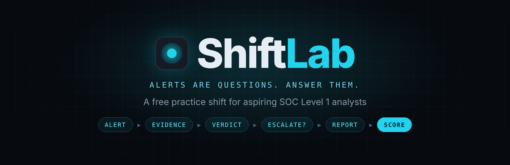
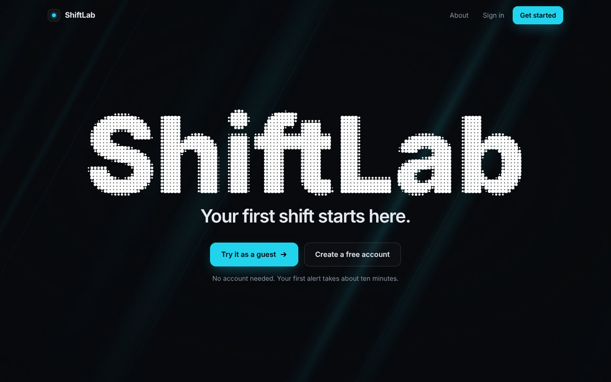
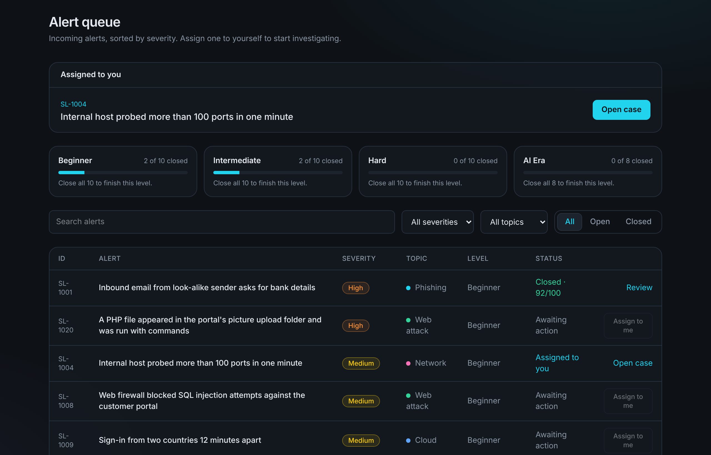
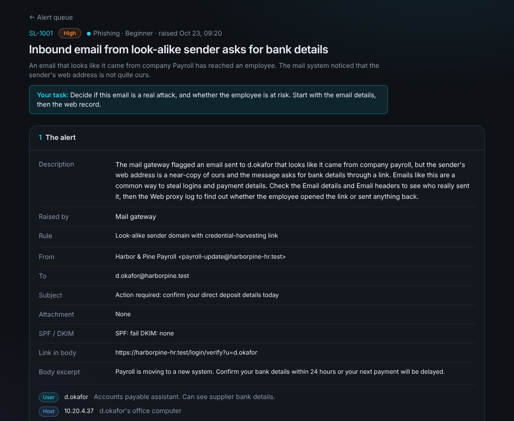
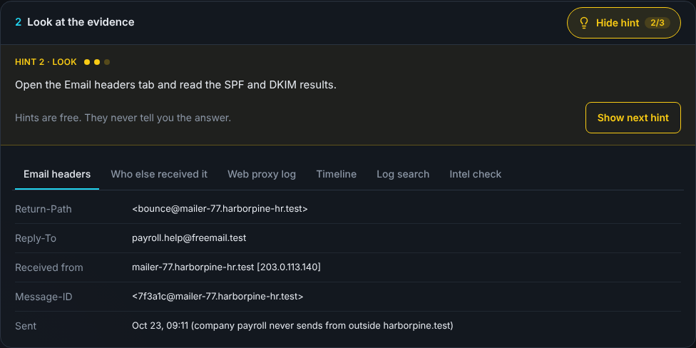
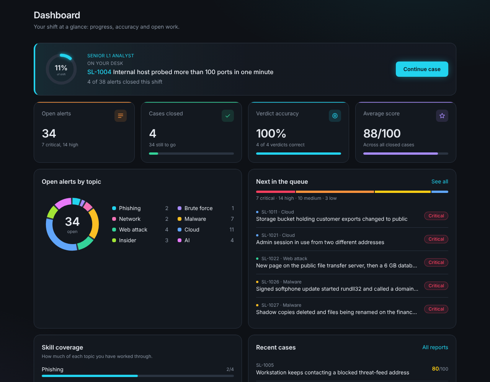
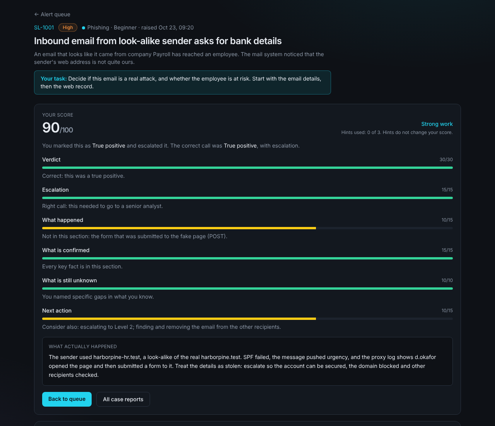
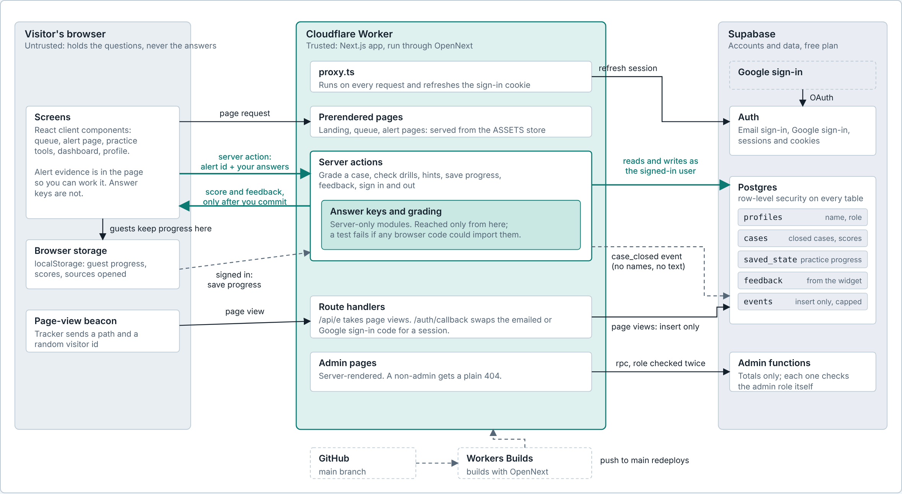

<div align="center">



**Take alerts from a queue, read the evidence, decide if it is a real attack, write your report, get scored.**


[](https://github.com/sai-707/shiftlab/actions/workflows/test.yml)
[](LICENSE)


**[Try it live](https://shiftlab.blueteam-labs.workers.dev)** &nbsp;·&nbsp; no account needed &nbsp;·&nbsp; [How it works](#how-a-shift-works) &nbsp;·&nbsp; [Run it yourself](#run-it-on-your-computer)



</div>

## Why it exists

Most beginner security training either shows you the answer or uses real data. ShiftLab makes you decide first, then explains. It is built for people learning the SOC L1 job: triage, reading evidence, writing a clear report, and knowing when to escalate.

Everything in it is fictional. The company is "Harbor & Pine Logistics", and every domain and address is a reserved test value (`.test` names and documentation IP ranges).

## How a shift works

1. **Take an alert** from the queue. Alerts are sorted by severity and grouped in four levels: Beginner, Intermediate, Hard and AI Era (prompt injection, deepfake voice fraud, stolen AI keys and similar). Every level is open from the start, so you can begin wherever you like.
2. **Investigate.** Each alert opens as labelled rows (datasource, timestamp, who and what), then evidence in tabs: logs, context, mail headers, timelines. On higher levels the report stays locked until you have opened enough sources, as a real analyst would.
3. **Decide and write.** True positive or false positive, whether to escalate, and a short report: what happened, what is confirmed, what is still unknown, and the next action.
4. **Get coached.** A score with a breakdown, what you missed, a model report, and how the real world compares. Free hints (think, look, find) never give the verdict and never change your score.

<table>
  <tr>
    <td width="50%"></td>
    <td width="50%"></td>
  </tr>
  <tr>
    <td align="center"><sub>The queue: four levels, all open</sub></td>
    <td align="center"><sub>One alert: labelled details, then evidence and your report</sub></td>
  </tr>
</table>

## What is in it

- **Alerts to work**, from a phishing email to an AI assistant that emailed out contracts, each with its own evidence, hints, answer key and model report.
- **Practice tools:** intel check (look up an address, domain or file hash), log search, a phishing mailbox, triage sprint, Shift mode (order and treat several alerts, optional clock), "Spot the AI's mistake", communication drills, shift handover, playbooks and a glossary.
- **Progress that follows you:** guests keep it in the browser; signed-in users (email or Google) have it saved to their account.
- **About page (`/guide`):** a plain-English explanation for someone who has never heard of a SOC. The words live in `content/guide.ts`; `public/ShiftLab-guide.pdf` is a two-page copy. Remake the PDF after changing the text.
- **Owner tools:** an admin dashboard with visitors, sign-ups and hardest alerts, a Guests page (how many people try it without an account and what they do), and a feedback inbox.



## Reports and dashboard

Closing a case feeds three pages that show how you are doing.

<table>
  <tr>
    <td width="50%"></td>
    <td width="50%"></td>
  </tr>
  <tr>
    <td align="center"><sub>Dashboard: progress, accuracy, average score, skill coverage</sub></td>
    <td align="center"><sub>Case feedback: six scored parts and what actually happened</sub></td>
  </tr>
</table>

- **Dashboard:** your shift at a glance, with a Continue case button, open alerts, cases closed, verdict accuracy, average score, open alerts by topic and skill coverage.
- **Case feedback:** a score out of 100 split into verdict, escalation, what happened, what is confirmed, what is still unknown and next action, each with coaching.
- **Case reports:** every report you have written, kept together to look back on.

## Feature tour

Every screen with a short description is in [`docs/FEATURES.md`](docs/FEATURES.md): the queue, case feedback, dashboard, case reports, shift handover, intel check, log search, phishing mailbox, triage sprint, Shift mode, Spot the AI's mistake, communication practice, analyst tools and the glossary.

## How it is built

| Part | Choice |
|---|---|
| App | Next.js 16 (App Router), React 19, TypeScript (strict) |
| Styling | Tailwind CSS 4 |
| Accounts and saved progress | Supabase (email and Google sign-in, saved progress, analytics events) with row-level security |
| Hosting | Cloudflare Workers through the OpenNext adapter (free plan) |

**The one rule behind the design: the browser may see the questions, never the answers.** The answer keys (`content/*-keys.ts`) and the grading code (`lib/grade.ts`, `lib/review.ts`) only run on the server, behind server actions. A test (`tests/boundary.test.mjs`) walks the import graph from every client file and fails if any of them could reach an answer key.



```
app/          pages, server actions, route handlers
components/   the screens (case workspace, queue, dashboard, tools)
content/      alerts, hints, playbooks, intel and log data, and the server-only answer keys
lib/          grading, progress, sync, small stores
supabase/     SQL migrations, run in order
tests/        content and safety checks
```

More detail is in [`docs/ARCHITECTURE.md`](docs/ARCHITECTURE.md): how the server/browser split works, the data model, and how to add an alert. The map above is also a page with light and dark themes: download [`docs/runtime-map.html`](docs/runtime-map.html) and open it in a browser.

## Run it on your computer

You need Node.js 22.6 or newer and a free [Supabase](https://supabase.com) project.

```bash
npm install
```

Create a file called `.env.local` in the project root:

```
NEXT_PUBLIC_SUPABASE_URL=your project URL
NEXT_PUBLIC_SUPABASE_PUBLISHABLE_KEY=your publishable (anon) key
```

Use only the publishable key. Never put a secret or service-role key in this project.

In the Supabase SQL editor, run the files in `supabase/migrations/` in order (`0001` to `0008`). Then:

```bash
npm run dev      # http://localhost:3000
npm test         # content and safety checks
npm run build    # production build
```

To see the admin pages on your own copy, sign up once, then make that account an admin (the one SQL line is in [`docs/ARCHITECTURE.md`](docs/ARCHITECTURE.md)).

Deploy to Cloudflare Workers with `npm run deploy`.

## Tests

`npm test` runs checks that need no extra packages, and they also run on every push through GitHub Actions:

- every alert has the text, evidence and questions the page needs, and Beginner questions point at real evidence tabs;
- Hard and AI Era titles and asset labels do not state the finding;
- every alert has three hints, and every tab a hint names really exists;
- every alert has an answer key and a review key;
- no client code can reach an answer key or the grading code;
- sign-in redirects cannot leave the site.

## The answers are in this repo

ShiftLab is open source, so anyone can read the answer keys in `content/*-keys.ts`. The *live site* never sends an answer to your browser before you commit to yours, and scores are for learning, not for a test or a leaderboard. If you want the real exercise, don't peek.

## Contributing and security

Read [CONTRIBUTING.md](CONTRIBUTING.md) first (short). To report a security problem privately, see [SECURITY.md](SECURITY.md).

## Credits and licence

A student project that is still growing. The alerts, answers and scoring were written by the author, [Sai Daswadkar](https://github.com/sai-707).

The admin pages' layout was inspired by the "Dashboard 1" template at efferd.com and the account menu by "dropdown-menu-01" at 21st.dev. No code was copied from either: ShiftLab's versions are written from scratch with its own colours, fonts and logo.

Code and content: [MIT](LICENSE), copyright 2026 Sai Daswadkar. The name "ShiftLab" and its logo are not covered by the licence, so please give a published fork its own name.
