# ShiftLab feature tour

Every screen below is the real app, shown with a few cases already closed so the progress pages have something to show. Back to the [README](../README.md).

- [Work the queue](#work-the-queue): queue, case feedback
- [Reports and dashboard](#reports-and-dashboard): dashboard, case reports, shift handover
- [Practice and learn](#practice-and-learn): intel, logs, mailbox, sprint, shift mode, AI check, communication, tools, glossary

## Work the queue

### Alert queue

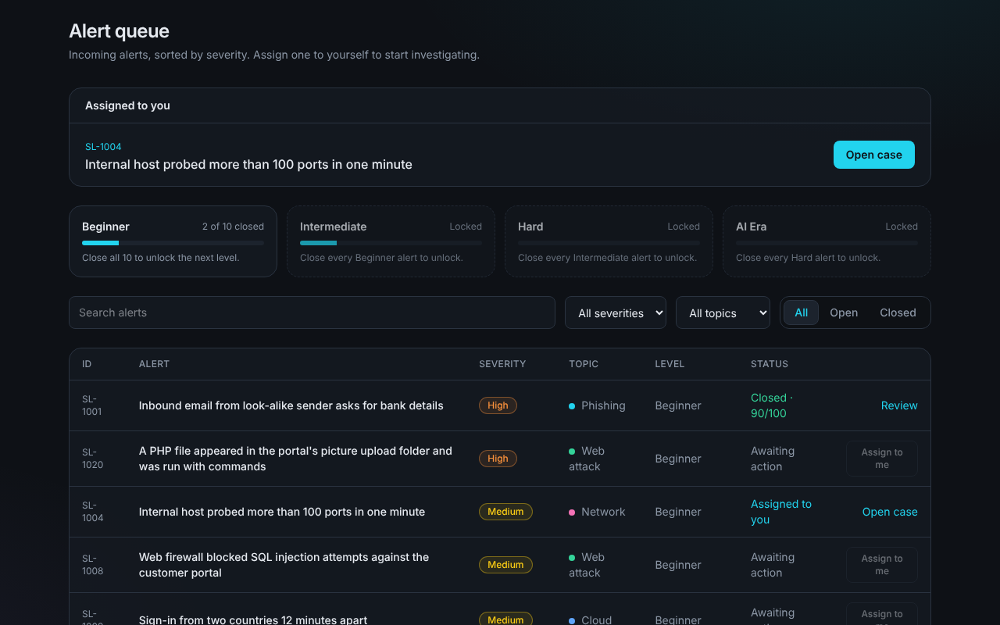

Alerts sorted by severity, with search, severity and topic filters and an Open / Closed switch. The alert you have assigned to yourself is pinned at the top. There are four levels (Beginner, Intermediate, Hard, AI Era) and all of them are open from the start.

### Case feedback

After you submit a case you get a score out of 100, split into six parts: verdict, escalation, what happened, what is confirmed, what is still unknown, and next action. Each part says what you got right and what to add, and the page ends with what actually happened. Hints are free and never change the score.

## Reports and dashboard

### Dashboard

Your shift at a glance: how far through the shift you are with a Continue case button, open alerts, cases closed, verdict accuracy and average score. Below those are open alerts by topic, the next most urgent alerts in the queue, skill coverage per topic, and your recent cases.

### Case reports

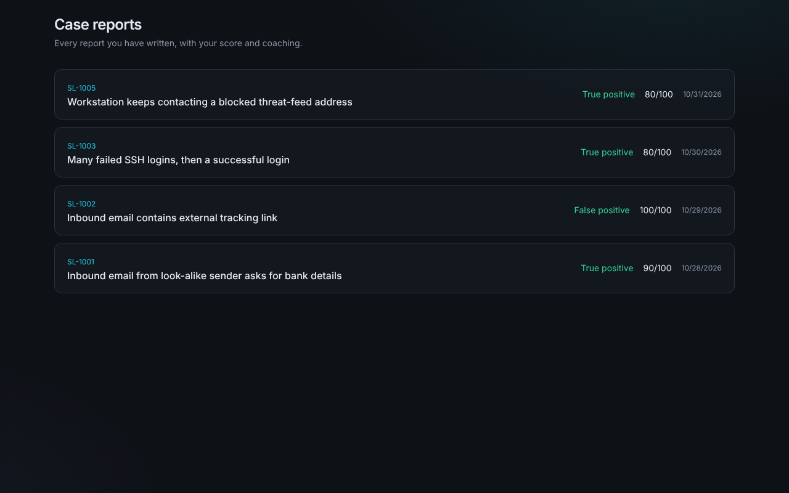

Every report you have written, newest first, with the verdict, score and date. Open one to go back to the case and its feedback.

### Shift handover

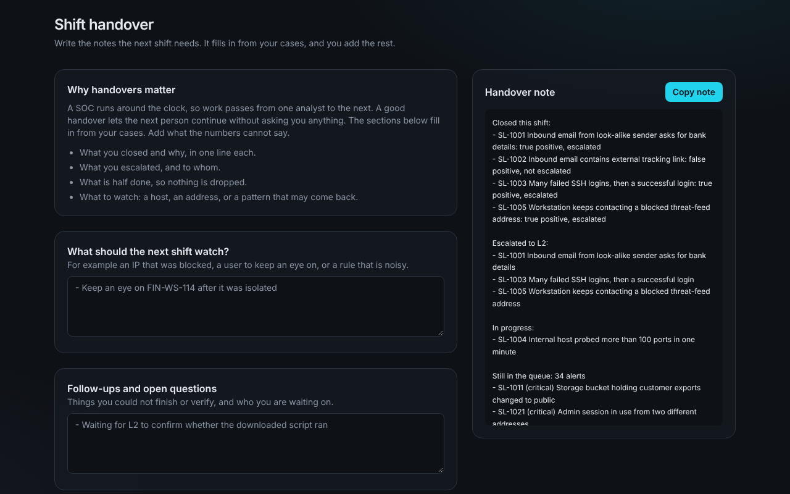

Writes the note the next shift needs. It fills in what you closed, what you escalated, what is half done and what is still waiting in the queue. You add what to watch and the open questions, then copy the note.

## Practice and learn

### Intel check

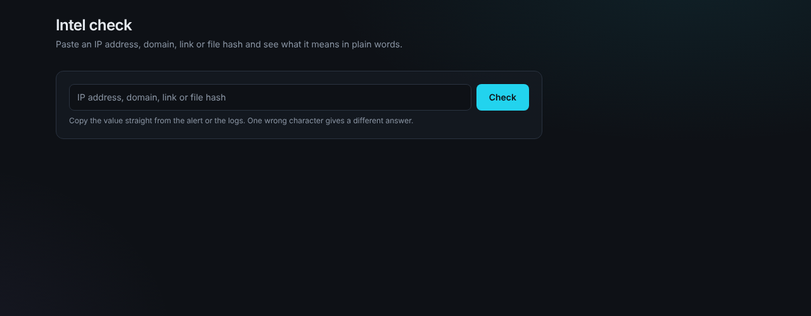

Paste an IP address, domain, link or file hash and get a plain-words answer, the way an analyst would check a threat feed. The data is made up and fixed, so every answer can be marked.

### Log search

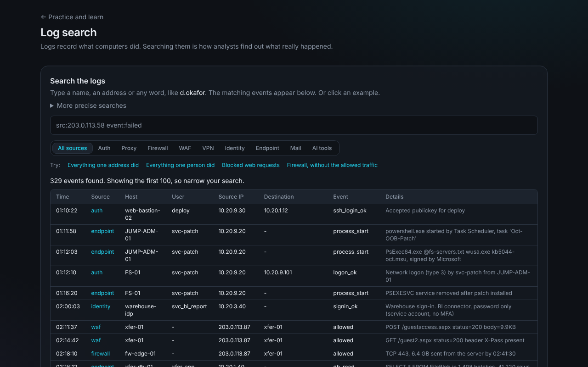

A small log search over made-up auth, proxy, firewall, WAF, VPN, identity, endpoint, mail and AI-tool logs. Type a word, or use field searches like `src:` and `event:`, and filter by source. Example searches are one click away.

### Phishing mailbox

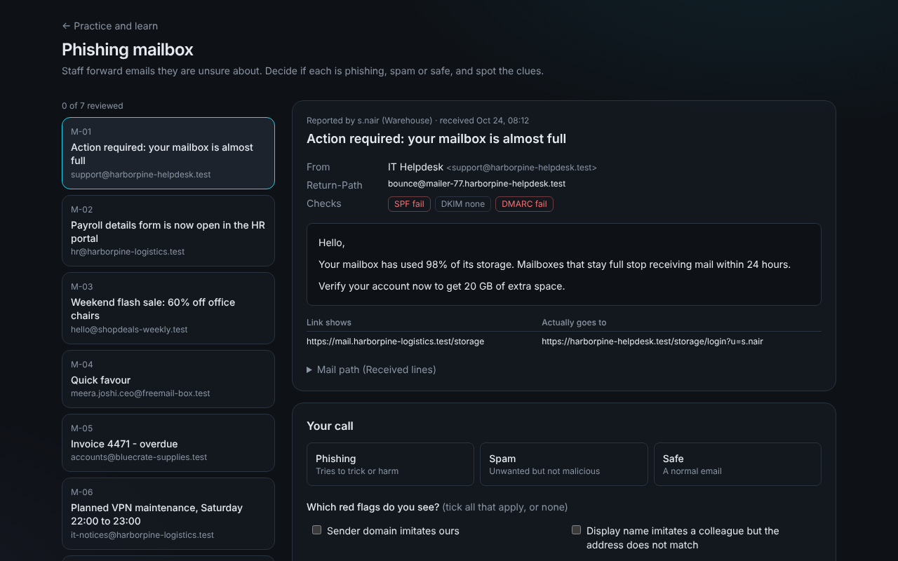

Staff forward emails they are unsure about. Open the headers, the SPF, DKIM and DMARC results and the link that is shown against where it really goes. Call each email phishing, spam or safe, and tick the red flags you can see.

### Triage sprint

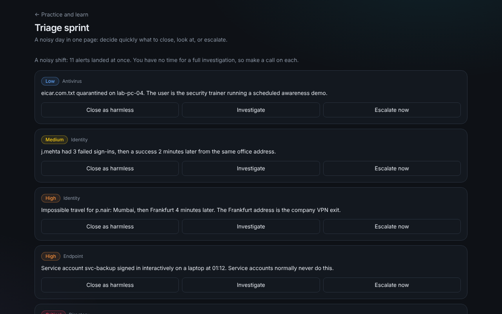

A noisy day on one page. For each alert decide in seconds: close as harmless, investigate, or escalate now. It teaches the call you make when you have no time for a full investigation.

### Shift mode

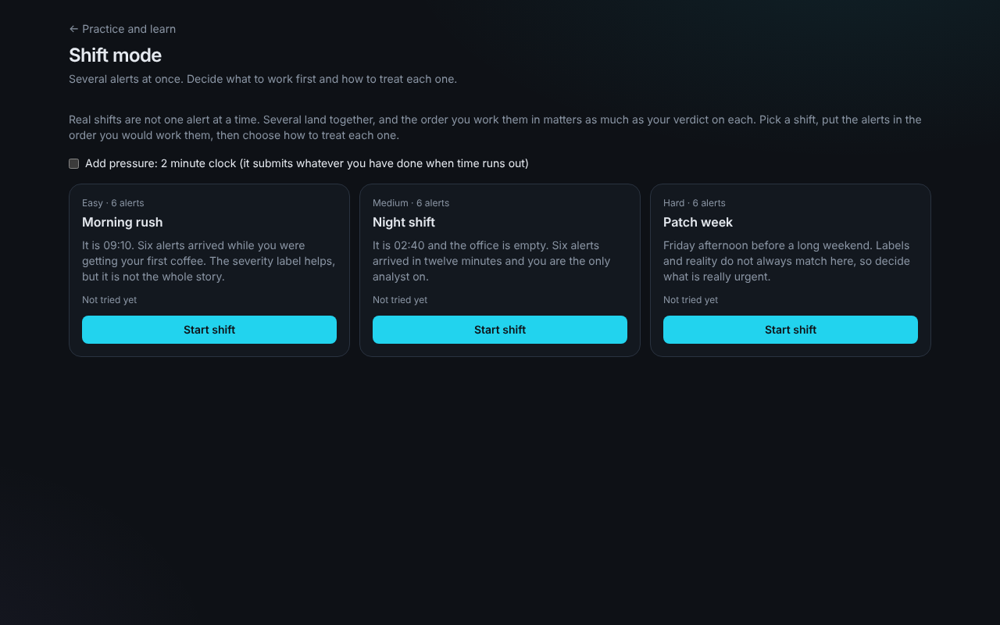

Several alerts land at once. Put them in the order you would work them, choose how to treat each, and optionally play against a two minute clock. Three shifts: Morning rush, Night shift and Patch week.

### Spot the AI's mistake

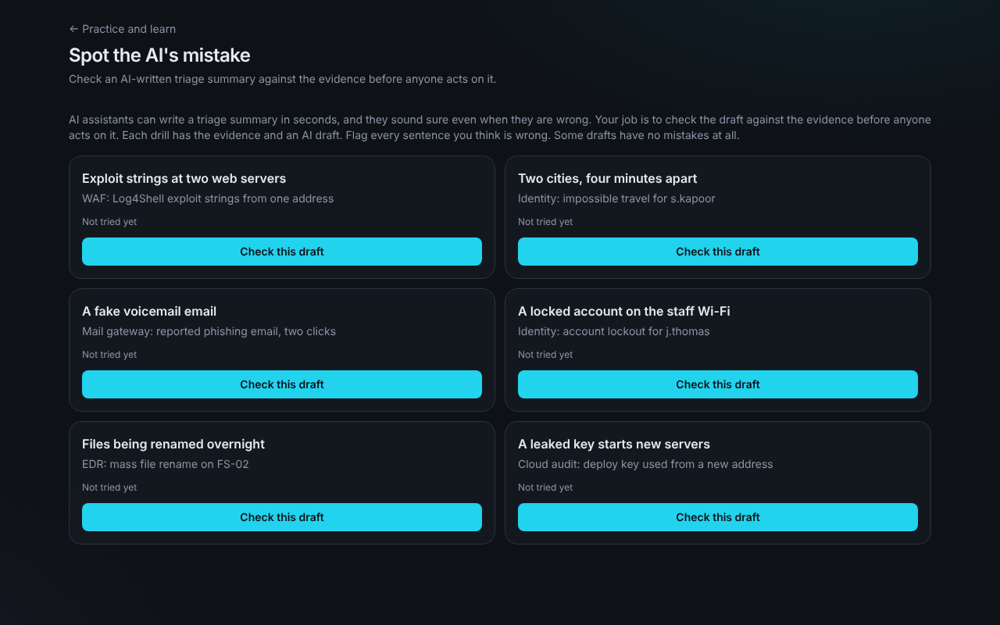

An AI writes a triage summary next to the evidence. Flag every sentence that is wrong. Some drafts have no mistakes, so reading the evidence matters more than distrusting the AI.

### Communication practice

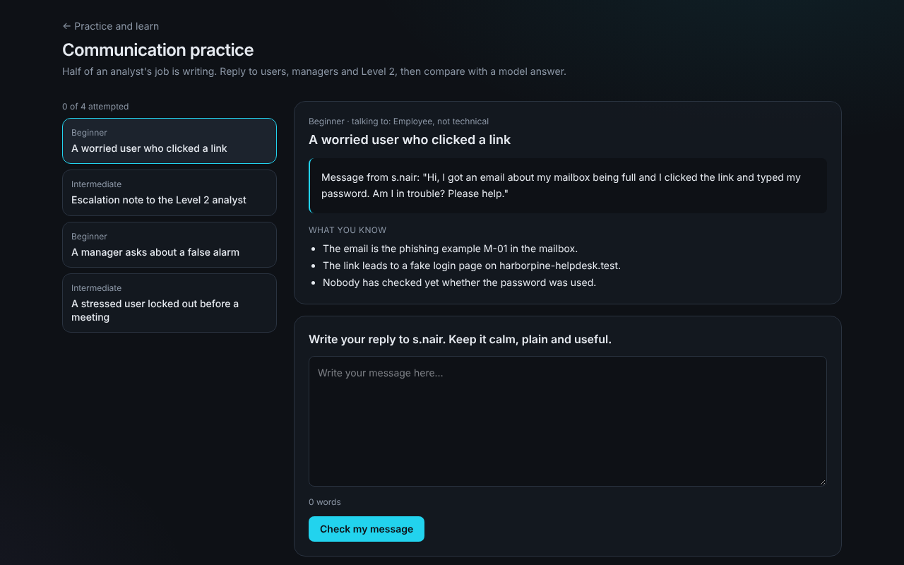

Half of the job is writing. Reply to a worried user, a manager or Level 2, then compare your message with a model answer.

### Analyst tools

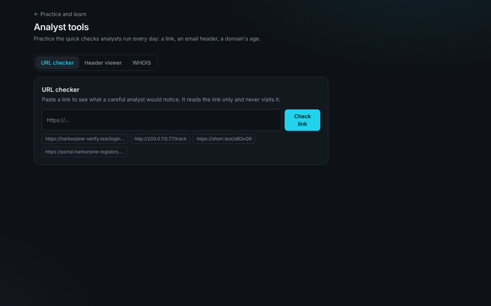

Three small tools for the daily checks: a URL checker that reads a link without visiting it, an email header viewer, and a WHOIS lookup for a domain's age.

### Glossary

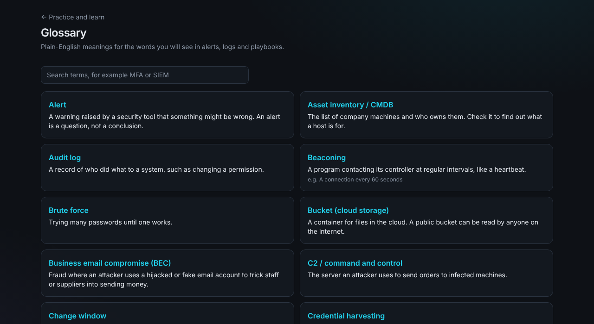

Plain-English meanings for the words in alerts, logs and playbooks, with a search box.

## Not shown here

- **Landing page and `/guide`**: see the README and `public/ShiftLab-guide.pdf`.
- **Owner pages** (visitors, sign-ups, guests, feedback inbox): these need real data from your own database, so they are not in the tour. Setup is in [`ARCHITECTURE.md`](ARCHITECTURE.md).
